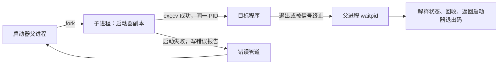

# 模块 10.2：父子进程、程序启动与退出回收

## 1. 当前进度与目标

模块 1～9 和 10-1 已完成。你对父子进程、fork、exec、waitpid 和僵尸进程“了解概念但没写过”，本课直接用项目内实践把这些概念连接起来，不重讲信号课，也不重复询问熟悉程度。

本课完成一个独立、单线程的启动器 process_launcher。它创建一个子进程，让子进程执行指定程序，区分启动阶段失败与程序自身退出，最终回收子进程并报告结果。

先用很小的 process_child 观察正常退出、非零退出与信号终止，再让同一个启动器启动已有 vision_pool_server。服务端源码不需要修改。

完整闭环是：




本课只启动一个直接子进程并等待它，不自动重启、不提供停止宽限期、不杀整组进程。那些属于随后进程监管的内容。主要源码由你亲手编写和运行；老师只维护讲义、CMake 和进度记录。

## 2. fork、exec、waitpid 各完成哪一步

| 操作 | 谁调用 | 完成什么 | 不代表什么 |
| --- | --- | --- | --- |
| fork | 启动器 | 创建子进程 | 目标程序已启动 |
| execv | 子进程 | 用目标程序替换当前程序映像 | 创建第三个进程、业务已就绪 |
| waitpid | 父进程 | 等待并取得子进程状态，回收退出记录 | 杀掉子进程、强制它返回 |

fork 成功后父子进程都从该调用之后继续执行，但得到不同返回值：


```cpp
const pid_t child_pid = ::fork();
// 父进程：child_pid > 0，是新子进程的 PID。
// 子进程：child_pid == 0，表示走子进程分支。
// 失败：返回 -1，没有创建子进程，查看 errno。
```

子进程分支里的 0 是 fork 的返回值，不是子进程真正的 PID；真正的 PID 用 getpid() 取得。

父子进程的普通变量不共享。fork 时初始内存内容相似，不等于随后修改同一个 vector；本课的启动错误必须通过管道交回，而不能靠修改某个局部变量。fork 的基本约定见 [Linux fork 文档](https://man7.org/linux/man-pages/man2/fork.2.html)。

### 2.1 为什么启动器单独运行

现有服务端已经有工作线程。多线程进程 fork 后，子进程只保留调用 fork 的线程，却可能复制了其他线程持有的锁状态；不能直接在那种子进程里随意继续复杂 C++ 逻辑。

本课启动器自身单线程，先 fork，再由子进程 exec 服务端；服务端进入自己的 main 后才创建工作线程。不要把这段启动逻辑随意塞进运行中的 ImageWorkerPool。

## 3. execv 的参数与“成功不返回”

本课调用：


```cpp
::execv(argv[1], argv + 1);
```

假设终端命令为：


```bash
./build/process_launcher ./build/process_child --exit-code 7
```

启动器收到的参数是：

| 下标 | 启动器 argv 中的值 |
| --- | --- |
| 0 | ./build/process_launcher |
| 1 | ./build/process_child |
| 2 | --exit-code |
| 3 | 7 |
| 4 | nullptr，参数数组结束 |

execv 的第一个参数指定可执行文件路径；第二个参数是传给新程序的字符串指针数组。argv+1 指向上表第 1 项，因此新程序收到：


```text
新程序 argv[0] = "./build/process_child"
新程序 argv[1] = "--exit-code"
新程序 argv[2] = "7"
新程序 argv[3] = nullptr
新程序 argc    = 3
```

execv 成功后，子进程运行目标程序，PID 不变，不会回来执行下一句。返回时则表示失败，返回 -1 并设置 errno。它按给定路径执行，不搜索 PATH；本课使用 ./build/...，相对路径以当前工作目录为基准。[exec 接口说明](https://man7.org/linux/man-pages/man3/exec.3.html)

启动器没有调用 shell，也不把参数重新拼成命令字符串。不要把“程序路径加所有参数”合并成一个 argv[1]；它们应由 shell 解析成多个参数后传给启动器。

## 4. 为什么不能只看退出码 127 判断启动失败

下面两种情况都可能出现子进程退出码 127：

1. execv 失败，启动器的子进程分支用 _exit(127) 结束。
2. execv 成功，目标程序自己执行 return 127。

仅靠最终退出码无法区分。因此本课建立一条专门的启动错误管道：只有 exec 前的子进程代码会向它写报告，目标程序不会持有这条写端。

### 4.1 pipe 返回的两个描述符


```cpp
int pipe_fds[2];
::pipe(pipe_fds);
// pipe_fds[0]：读端
// pipe_fds[1]：写端
```

这是同机进程通信，不是 TCP。pipe 成功返回 0，失败返回 -1；两个 fd 由数组输出。它是字节流，因此代码仍按实际 read/write 返回值累计偏移，不假定一次必定收齐一份结构体。[pipe 接口](https://man7.org/linux/man-pages/man2/pipe.2.html)

fork 后父子都继承了管道描述符的副本，本课立即关闭不需要的那一端：


```text
fork 之前：父进程持有 读端、写端
fork 之后：
  父进程保留读端，关闭自己的写端
  子进程关闭自己的读端，保留写端
```

当所有写端引用都关闭、已写数据也读尽时，读端返回 0，即 EOF。如果父进程忘记关闭自己那份写端，即使子进程已经退出，父进程也可能一直等不到 EOF。[管道 EOF 语义](https://man7.org/linux/man-pages/man7/pipe.7.html)

### 4.2 FD_CLOEXEC 在什么时候关闭写端

在 fork 前给写端设置：


```cpp
::fcntl(write_end->get(), F_SETFD, FD_CLOEXEC);
```

FD_CLOEXEC 的含义是成功执行 exec 时自动关闭该描述符。它不阻止 fork 继承，也不会在设置标志的这一刻关闭管道。此处是刚创建的管道写端，设置这个描述符标志即可。

于是：

| 子进程路径 | 错误管道表现 |
| --- | --- |
| execv 返回失败 | 写入阶段与 errno，然后 _exit |
| execv 成功 | 写端因 FD_CLOEXEC 自动关闭，正常情况下父进程读到无报告的 EOF |

描述符与信号动作在 exec 前后的保留规则见 [execve 文档](https://man7.org/linux/man-pages/man2/execve.2.html)。

**EOF 只表示没有剩余写端和数据，不是业务就绪通知。** 子进程若在报告前被信号终止，也可能产生无报告的 EOF；动态加载器失败也可能发生在 exec 已完成之后。因此日志写“未收到失败报告”，不武断地写“服务端启动成功”。最后仍须 waitpid；连接服务端前仍需看它自己的监听提示。

## 5. waitpid 的参数、状态和僵尸进程

本课调用：


```cpp
int status = 0;
const pid_t result = ::waitpid(child_pid, &status, 0);
```

- child_pid 为正：只等待这个直接子进程。
- &status：输出等待状态；它包含退出方式等信息，不是裸退出码。
- 第三个参数 0：本课采用阻塞等待，不轮询。
- 成功返回被回收子进程的 PID；失败返回 -1，EINTR 时重试。

取得状态后先判断类别，再提取对应字段：


```cpp
if (WIFEXITED(status)) {
    const int code = WEXITSTATUS(status);
}
if (WIFSIGNALED(status)) {
    const int signo = WTERMSIG(status);
}
```

WIFEXITED 表示经正常进程退出机制结束，包括 return 7；“正常退出”不等于业务成功。WIFSIGNALED 表示被信号终止。不要对被信号终止的状态直接用 WEXITSTATUS。

子进程结束后，系统通常保留少量退出信息，等待父进程回收；尚未回收的这个状态就是僵尸进程。它不是仍在执行计算、需要再杀一次的活进程。waitpid 负责取得状态并完成回收。[waitpid 文档](https://man7.org/linux/man-pages/man2/waitpid.2.html)

本课不使用 WNOHANG；下一步监管需要边等待边处理停止和期限时，再讨论怎样改变等待方式。

## 6. 文件与动手位置

所有路径相对于 /home/rikanshin/VisionFlow/VisionFlow_learn。

| 文件 | 谁写入 | 内容 |
| --- | --- | --- |
| apps/process_child.cpp | 你新建 | 可控退出状态的小程序 |
| apps/process_launcher.cpp | 你新建 | fork、错误管道、execv、waitpid |
| CMakeLists.txt | 老师已追加条件式目标 | 两个入口的构建配套 |
| 已有 vision_pool_server.cpp、tcp_io.hpp/cpp | 保留 | 服务端和描述符 RAII |

SocketFd 虽然名字带 Socket，但实际只是检查并关闭 fd，因此也能管理管道。父进程的写端使用上一课已经学过的 optional<SocketFd>，通过 reset 提前关闭，不再另写一个资源包装类。

## 7. apps/process_child.cpp 完整内容

由你新建该文件：


```cpp
#include <csignal>
#include <exception>
#include <iostream>
#include <stdexcept>
#include <string>
#include <unistd.h>

int main(int argc, char* argv[]) {
    try {
        int exit_code = 0;
        bool terminate_by_signal = false;
        if (argc == 3 && std::string(argv[1]) == "--exit-code") {
            const std::string text = argv[2];
            if (text.empty() || text.size() > 3 ||
                text.find_first_not_of("0123456789") != std::string::npos) {
                throw std::invalid_argument("退出码必须为 0～255 的整数");
            }
            exit_code = std::stoi(text);
            if (exit_code > 255) {
                throw std::invalid_argument("退出码不得超过 255");
            }
        } else if (argc == 2 && std::string(argv[1]) == "--signal-term") {
            terminate_by_signal = true;
        } else if (argc != 1) {
            throw std::invalid_argument(
                "用法：process_child [--exit-code 0到255 | --signal-term]");
        }

        std::cout << "示例子进程：PID=" << ::getpid()
                  << "，PPID=" << ::getppid() << std::endl;
        if (terminate_by_signal) {
            std::cout << "示例子进程准备向自身发送 SIGTERM" << std::endl;
            ::raise(SIGTERM);
            throw std::runtime_error("SIGTERM 未终止进程，请检查信号设置");
        }
        std::cout << "示例子进程准备正常退出，退出码：" << exit_code << std::endl;
        return exit_code;
    } catch (const std::exception& error) {
        std::cerr << "示例子进程失败：" << error.what() << '\n';
        return 1;
    }
}
```

### 7.1 这个小程序控制什么

不带参数时返回 0；--exit-code 允许你选择 0～255；--signal-term 则向自身发送 SIGTERM。它不创建自己的子进程。

getpid 显示自己是谁，getppid 显示当前父进程是谁。由启动器启动时，PPID 应对应启动器打印的 PID，而子进程 PID 应对应启动器 fork 返回的那个 PID。

### 7.2 为什么 raise 后面还写 throw

本课启动器会在 exec 前为子进程恢复 SIGTERM 默认动作并解除屏蔽，正常情况下 raise(SIGTERM) 终止进程，执行不到下一句。

若信号设置被改坏而没有终止，后面的 throw 会报告这一异常情况，避免样例悄悄返回成功。这个程序应按本课由启动器运行；它不是用来推断任意外部环境中的信号配置。

### 7.3 为什么主动把退出码限制到 0～255

本课希望输入值与父进程提取到的退出码直接对应，不让更大的整数经过退出状态截断后造成误解。这是观察程序的输入约定。

## 8. apps/process_launcher.cpp 完整内容

由你新建该文件。下面全部是一份入口代码，不需要复制进现有服务端：


```cpp
#include "tcp_io.hpp"

#include <cerrno>
#include <csignal>
#include <cstddef>
#include <exception>
#include <iostream>
#include <optional>
#include <stdexcept>
#include <system_error>
#include <utility>
#include <fcntl.h>
#include <sys/types.h>
#include <sys/wait.h>
#include <unistd.h>

namespace net = visionflow::net;

namespace {

enum class LaunchStage : int { signals = 1, exec = 2 };

struct LaunchError {
    LaunchStage stage;
    int code;
};

void check_call(int value, const char* message) {
    if (value < 0) {
        throw std::system_error(errno, std::generic_category(), message);
    }
}

class ChildProcess {
public:
    explicit ChildProcess(pid_t pid) : pid_(pid) {}
    ChildProcess(const ChildProcess&) = delete;
    ChildProcess& operator=(const ChildProcess&) = delete;

    ~ChildProcess() {
        if (pid_ > 0) {
            int status = 0;
            while (::waitpid(pid_, &status, 0) < 0 && errno == EINTR) {
            }
        }
    }

    int wait() {
        if (pid_ <= 0) {
            throw std::logic_error("子进程已回收，不能重复等待");
        }
        int status = 0;
        for (;;) {
            const pid_t result = ::waitpid(pid_, &status, 0);
            if (result == pid_) {
                pid_ = -1;
                return status;
            }
            if (result < 0 && errno == EINTR) {
                continue;
            }
            throw std::system_error(errno, std::generic_category(),
                                    "等待子进程失败");
        }
    }

private:
    pid_t pid_;
};

[[noreturn]] void child_failed(
    int error_fd, LaunchStage stage, int error_code) {
    const LaunchError report{stage, error_code};
    const auto* bytes = reinterpret_cast<const char*>(&report);
    std::size_t sent = 0;
    while (sent < sizeof(report)) {
        const auto count = ::write(error_fd, bytes + sent, sizeof(report) - sent);
        if (count > 0) {
            sent += static_cast<std::size_t>(count);
        } else if (count < 0 && errno == EINTR) {
            continue;
        } else {
            break;
        }
    }
    ::_exit(127);
}

std::optional<LaunchError> read_launch_error(int fd) {
    LaunchError report{};
    auto* bytes = reinterpret_cast<char*>(&report);
    std::size_t received = 0;
    while (received < sizeof(report)) {
        const auto count = ::read(fd, bytes + received, sizeof(report) - received);
        if (count > 0) {
            received += static_cast<std::size_t>(count);
        } else if (count == 0) {
            if (received == 0) {
                return std::nullopt;
            }
            throw std::runtime_error("启动错误报告不完整");
        } else if (errno != EINTR) {
            throw std::system_error(errno, std::generic_category(),
                                    "读取启动错误报告失败");
        }
    }
    if ((report.stage != LaunchStage::signals &&
         report.stage != LaunchStage::exec) || report.code <= 0) {
        throw std::runtime_error("启动错误报告格式不正确");
    }
    return report;
}

int describe_status(int status) {
    if (WIFEXITED(status)) {
        const int code = WEXITSTATUS(status);
        std::cout << "子进程正常退出，退出码：" << code << std::endl;
        return code;
    }
    if (WIFSIGNALED(status)) {
        const int signo = WTERMSIG(status);
        std::cout << "子进程被信号终止，信号编号：" << signo << std::endl;
        return 128 + signo; // 本启动器采用的退出码映射约定。
    }
    throw std::runtime_error("收到非预期的子进程状态");
}

} // namespace

int main(int argc, char* argv[]) {
    try {
        if (argc < 2) {
            std::cerr << "用法：process_launcher 程序路径 [程序参数...]\n";
            return 125;
        }

        struct sigaction ignored{};
        ignored.sa_handler = SIG_IGN;
        check_call(::sigemptyset(&ignored.sa_mask), "初始化信号动作失败");
        check_call(::sigaction(SIGINT, &ignored, nullptr),
                   "设置父进程 SIGINT 动作失败");

        struct sigaction defaults{};
        defaults.sa_handler = SIG_DFL;
        check_call(::sigemptyset(&defaults.sa_mask), "初始化默认信号动作失败");
        check_call(::sigaction(SIGCHLD, &defaults, nullptr),
                   "设置子进程回收方式失败");

        sigset_t child_unblock;
        check_call(::sigemptyset(&child_unblock), "初始化子进程信号集合失败");
        check_call(::sigaddset(&child_unblock, SIGINT), "添加 SIGINT 失败");
        check_call(::sigaddset(&child_unblock, SIGTERM), "添加 SIGTERM 失败");

        int pipe_fds[2];
        check_call(::pipe(pipe_fds), "创建启动错误管道失败");
        net::SocketFd read_end(pipe_fds[0]);
        std::optional<net::SocketFd> write_end(std::in_place, pipe_fds[1]);
        check_call(::fcntl(write_end->get(), F_SETFD, FD_CLOEXEC),
                   "设置启动错误管道关闭标志失败");

        std::cout << std::flush;
        std::cerr << std::flush;
        const pid_t child_pid = ::fork();
        check_call(child_pid, "创建子进程失败");

        if (child_pid == 0) {
            ::close(read_end.get());
            const int error_fd = write_end->get();
            if (::sigaction(SIGINT, &defaults, nullptr) < 0 ||
                ::sigaction(SIGTERM, &defaults, nullptr) < 0 ||
                ::sigprocmask(SIG_UNBLOCK, &child_unblock, nullptr) < 0) {
                child_failed(error_fd, LaunchStage::signals, errno);
            }
            ::execv(argv[1], argv + 1);
            child_failed(error_fd, LaunchStage::exec, errno);
        }

        ChildProcess child(child_pid);
        write_end.reset();
        std::cout << "启动器 PID：" << ::getpid()
                  << "，子进程 PID：" << child_pid << std::endl;

        const auto launch_error = read_launch_error(read_end.get());
        if (launch_error) {
            const char* stage = launch_error->stage == LaunchStage::exec
                ? "execv" : "信号设置";
            std::cerr << "子进程启动失败，阶段：" << stage
                      << "，原因："
                      << std::system_error(launch_error->code,
                                           std::generic_category()).what()
                      << std::endl;
        } else {
            std::cout << "启动错误通道已关闭，未收到失败报告；等待子进程结束"
                      << std::endl;
        }

        const int status = child.wait();
        const int child_code = describe_status(status);
        const int launcher_code = launch_error ? 125 : child_code;
        std::cout << "子进程已回收，启动器退出码：" << launcher_code << std::endl;
        return launcher_code;
    } catch (const std::exception& error) {
        std::cerr << "启动器失败：" << error.what() << '\n';
        return 125;
    }
}
```

## 9. 对照启动器：资源和回收职责

### 9.1 ChildProcess 管的是“回收责任”

它保存一个正的子进程 PID，不持有 fd。wait 成功后将 pid_ 设为 -1，表示这份回收责任已完成；重复调用 wait 会报错，避免不小心把 -1 传给 waitpid 而等待了其他孩子。

显式 wait 中若被信号打断，EINTR 重试；成功才解释 status。析构也会在仍有有效 PID 时尝试等待，目的是让父进程在后续读取报告或输出发生异常时，仍有回收子进程的兜底路径。

这个析构可能阻塞，不会强制终止子进程，也不承诺截止时间；若 waitpid 本身遇到非 EINTR 错误，析构不会继续无限重试或抛异常。正常路径使用显式 wait，让等待错误能够被 main 捕获和报告。它不是完整的监管器。

### 9.2 为什么只在父分支构造 ChildProcess

子进程在 child_pid==0 的分支中要么 exec 成功、不再回来，要么 child_failed 后 _exit，也不再回来。

所以后面的 ChildProcess child(child_pid) 只由父进程执行，此时 child_pid 是一个正的真实 PID。不能拿子分支中的 0 构造这份等待责任。

### 9.3 管道两端的 RAII

父进程中的 read_end 随 main 作用域结束关闭，write_end 在 fork 后立即 reset，避免自己保留写端造成无法读到 EOF。

子分支手动关闭自己不需要的 read_end，随后一定 exec 或 _exit，不会再运行旧 C++ 局部对象的析构，因此不会回到父分支或重复执行启动器收尾。父进程的 read_end 副本仍有效，子进程的 close 不会把父进程的描述符一起关掉。

pipe 和 fork 失败发生在子进程未创建的路径上时，已有描述符仍由 RAII 回收。

## 10. 对照启动器：错误管道如何读写

### 10.1 LaunchError 的内存布局用途

LaunchStage 标记失败发生在信号设置还是 execv，code 保存该次调用的 errno。

本课直接传输这个小结构体的字节，因为两端来自同一个程序的一次 fork，使用相同 ABI。它不是跨机器协议，没有 VFLW 头，也不把原始内存布局推广成通用序列化方案。

### 10.2 child_failed 为什么不使用 cout 或 throw

exec 失败后先把 errno 作为参数传入，避免随后其他调用覆盖原因。child_failed 用 write 循环发送错误报告，处理短写和 EINTR，然后调用 _exit(127)。

子分支不抛 C++ 异常回到父进程的通用 catch，也不跑父进程的日志和析构流程。_exit 不进行普通用户态退出清理或刷新标准 I/O 缓冲；这些区别见 [_exit 文档](https://man7.org/linux/man-pages/man2/_exit.2.html)。

[[noreturn]] 告诉编译器这个函数不会正常返回。它对应的是控制流约定，不是让函数自动结束进程；真正结束进程的是 _exit。

注意 return 的含义由所在函数决定：普通辅助函数 return 返回调用点；main 中 return 正常结束进程，并进行正常退出清理，不会继续 main 的后半段。本课 child_failed 声明为 [[noreturn]]，不能正常返回。_exit 直接终止当前进程，不执行 C++ 对象析构、atexit 回调或刷新用户态标准 I/O 缓冲，避免重复执行 fork 继承的退出清理；内核仍会关闭描述符等，并保留可由父进程回收的退出状态。

父进程在 fork 前 flush 已有标准流，子分支也不刷新旧缓冲，避免把 fork 前尚未输出的数据再输出一次。

### 10.3 read_launch_error 的三类结果

| 情况 | 返回或行为 |
| --- | --- |
| 读满一份合法错误记录 | 返回有值的 optional<LaunchError> |
| 未读到任何数据即 EOF | 返回 nullopt，表示没有错误报告 |
| 部分记录后 EOF、读取失败或字段非法 | 抛异常，由父进程处理并尝试回收子进程 |

管道的 read 是阻塞式的；父进程等待 exec 关闭写端或子分支提交错误报告。这是本课的单子进程顺序启动流程，不把它塞进已有网络事件循环。

报告写入本身如果失败，或子进程来不及报告就终止，父进程可能只能依靠 waitpid 状态判断发生了什么。因此日志措辞必须区分“未收到报告”与“已经证明启动成功”。

## 11. 对照启动器：信号设置与 Ctrl+C

### 11.1 父进程为什么忽略 SIGINT

从交互终端以前台方式运行启动器，fork 出来的孩子通常仍在同一前台进程组。按 Ctrl+C 时，终端会通知这组进程，父进程和孩子都可能收到 SIGINT。

本课父进程设置 SIGINT 为 SIG_IGN，让它继续承担 waitpid 和打印回收状态的责任。它没有把 SIGINT 转发给孩子；同组信号投递是终端和内核完成的。

这是本课前台单子进程实验的策略，不是完整后台服务监管。仅向父 PID 发送 SIGINT，不等同于向前台进程组按 Ctrl+C；父进程也没有实现退出期限或自动转发 SIGTERM。

### 11.2 子进程为什么恢复动作、解除屏蔽

子进程继承父进程的信号设置，而忽略的动作可能跨 exec 保留。若忘记恢复，目标程序可能意外继承 SIGINT 忽略行为。

所以子分支在 exec 前：

- 把 SIGINT 和 SIGTERM 的动作设为 SIG_DFL。
- 用 SIG_UNBLOCK 解除这两个信号的屏蔽。
- 失败则通过错误管道报告 signals 阶段。

这里使用 sigprocmask，因为启动器单线程，fork 后的子分支也只有一个线程；它的返回方式与上一课 pthread_sigmask 不同，失败返回 -1 并设置 errno。

目标 vision_pool_server 进入自己的 main 后，会按 10-1 的实现再次屏蔽停止信号，并用 signalfd 接收。这是目标程序自己的初始化，不由启动器替它执行。

### 11.3 父进程为什么设置 SIGCHLD 默认动作

本课需要正常取得孩子的退出状态，不采用显式忽略 SIGCHLD 或自动放弃退出记录的方式。把 SIGCHLD 设为 SIG_DFL，使启动器按本课的 waitpid 路径回收。

这里没有安装 SIGCHLD 回调；阻塞式 waitpid 本身承担等待职责。停止信号与子进程回收状态是两类不同信息，不把 SIGINT 当作“子进程已经退出”。

## 12. 三种数字不要混淆

| 数字 | 示例 | 从哪里获得 |
| --- | --- | --- |
| 子进程 PID | 每次运行变化 | fork 在父分支的返回值 |
| wait 状态 status | 包含退出方式的编码 | waitpid 的输出参数 |
| 目标程序退出码 | 7 或 127 | 先 WIFEXITED，再 WEXITSTATUS |

本启动器自己的退出码规则如下：

| 观察结果 | 启动器返回 |
| --- | --- |
| 无启动错误报告，子进程正常退出 | 原子进程退出码 |
| 无启动错误报告，子进程被信号终止 | 128 + 信号编号 |
| 收到启动阶段错误报告 | 125 |
| 启动器自身参数、系统调用或协议错误 | 125 |

128+signo 是本启动器采用的约定，不是 waitpid 直接返回了这个数字。125 也不是全世界保留的唯一错误类别：目标程序自己也能返回 125，所以最终仍要结合启动错误报告与日志理解。

例如，process_child --exit-code 127 应显示目标程序正常退出 127，启动器返回 127；不存在的路径则有 execv 错误报告，子分支内部 _exit(127)，但启动器返回 125。这就是错误管道提供的额外信息。

## 13. CMake 配套

老师已追加以下条件式目标，不需要你重复添加：


```cmake
# 模块 10.2：学生写齐进程观察入口后，自行重新配置。
if(EXISTS "${CMAKE_CURRENT_SOURCE_DIR}/apps/process_child.cpp")
    add_executable(process_child apps/process_child.cpp)
endif()

if(EXISTS "${CMAKE_CURRENT_SOURCE_DIR}/apps/process_launcher.cpp")
    add_executable(process_launcher
        apps/process_launcher.cpp
        src/tcp_io.cpp
    )
    target_include_directories(process_launcher PRIVATE
        ${CMAKE_CURRENT_SOURCE_DIR}/include
    )
endif()
```

process_child 不需要网络或 OpenCV。process_launcher 只链接 tcp_io.cpp 复用 SocketFd，包含目录仍为 include。它本身不链接图像处理库、也不创建线程。

由 exec 启动的服务端是另一个程序映像，它的 OpenCV 和线程依赖已由原目标处理；不把服务端源文件再编译进启动器。

两个入口文件写齐之后，你自行重新配置生成目标。EXISTS 只检查文件是否存在，不代表已经构建成功。

## 14. 由你执行的集中实践

### 14.1 配置与构建


```bash
cd /home/rikanshin/VisionFlow/VisionFlow_learn
cmake -S . -B build
cmake --build build --target process_launcher process_child -j2
```

老师没有执行这些命令。以下输出均为预期，实际 PID、系统错误详情及父子日志交错顺序可能不同。

### 14.2 正常退出但返回非零


```bash
./build/process_launcher ./build/process_child --exit-code 7
echo $?
```

应看到子进程 PID 与启动器打印的一致，PPID 对应启动器 PID；没有启动错误报告，waitpid 判断为正常退出，提取到 7，启动器也返回 7。

“返回非零”不意味着 fork 或 exec 失败。这个样例正是由目标程序主动选择非零结果。

### 14.3 比较主动退出 127 与 exec 失败

先执行：


```bash
./build/process_launcher ./build/process_child --exit-code 127
echo $?
```

预期无启动错误报告，子进程正常退出 127，启动器返回 127。

再执行一个不存在的目标路径：


```bash
./build/process_launcher ./build/definitely_missing_lesson10_child
echo $?
```

该路径应不存在；若你自行创建了这个名字的文件，换一个不存在的路径。本次预期有“子进程启动失败，阶段：execv”及系统原因，内部子分支退出 127，但启动器返回 125，并报告子进程已回收。

这两次对比说明：fork 成功有子 PID，不等于 exec 成功；子退出码相同，也不等于经历了相同执行路径。

### 14.4 由信号终止


```bash
./build/process_launcher ./build/process_child --signal-term
echo $?
```

示例子进程会向自己发送 SIGTERM，不发送给其他 PID。Linux 下 SIGTERM 编号为 15，因此预期父进程报告“被信号终止，信号编号：15”，启动器按约定返回 143。

不要把 143 说成目标程序执行了 return 143；目标程序没有走到正常 return。这正是 WIFSIGNALED 与 WIFEXITED 的区别。

### 14.5 启动现有服务端并回收

确保此前服务端已停止，然后在终端 A 执行：


```bash
./build/process_launcher ./build/vision_pool_server
```

启动器先报告自己和孩子的 PID；服务端自己的“服务端 PID”应与孩子 PID 对应。父子日志可能交错，不能凭哪行先打印判断谁先被创建。

等服务端出现监听提示后，在终端 B 用现有客户端发送一个请求：


```bash
cd /home/rikanshin/VisionFlow/VisionFlow_learn
python3 python/vision_client.py samples/frame.jpg
echo $?
```

预期仍得到 request_id=42 的原样本处理结果，客户端退出码 0。这里观察的是“通过启动器启动的真实服务端能够服务请求”，不再重复旧课的六请求与带任务停止实验。

请求完成后，在终端 A 按一次 Ctrl+C。预期顺序包含：


```text
服务端读到 SIGINT，执行 10-1 的正常停止
服务端打印工作线程已回收，正常退出
启动器报告：子进程正常退出，退出码：0
启动器报告：子进程已回收，启动器退出码：0
```

终端 A 回到提示符后立即执行 echo $?，预期为 0。此时 shell 查看的是启动器的退出码；启动器日志中同时报告了子服务端的退出方式。

父进程忽略 SIGINT 不等于孩子一定退出：若目标程序卡住或忽略停止请求，启动器仍可能一直等待。本课不通过这一例宣称实现了强制停止或完整监管。

### 14.6 集中反馈什么

请贴构建结果，以及上述各次运行的输出和紧接着的 echo $?。这些短观察分别验证参数转交、正常非零退出、启动失败区分、信号终止和实际服务端接入，不要求重复模块 9 或 10-1 的全部实验。

未运行的分支不记作已验证。管道创建失败、fork 资源不足、报告短读等防御分支没有这些正常观察的直接证据，老师不额外要求故意耗尽资源。

## 15. 报错定位入口

| 现象 | 优先检查 |
| --- | --- |
| 找不到新构建目标 | 两个入口是否写齐，之后是否重新配置 |
| undefined reference 到 SocketFd | process_launcher 是否包含 src/tcp_io.cpp |
| execv 报找不到文件 | 当前工作目录、argv[1] 路径，是否错误地把所有参数合并成一个字符串 |
| 子程序说参数格式错误 | 是否使用 argv+1，把目标路径作为新 argv[0] |
| 目标程序运行了，但启动器卡在读报告 | 父进程是否关闭自己的写端；子写端是否设置 FD_CLOEXEC |
| return 127 被误判成 exec 失败 | 是否只看退出码，忽略专用错误报告 |
| Ctrl+C 把启动器直接结束，没回收日志 | 父进程 SIGINT 是否设为忽略，是否运行了新构建结果 |
| 服务端不按预期处理停止 | 子分支是否恢复 SIGINT 动作并解除屏蔽，服务端是否已有 10-1 修改 |
| waitpid 报没有子进程 | 是否重复回收，或修改了 SIGCHLD 的回收约定 |
| 被信号终止却打印正常退出码 | 是否先用 WIFEXITED/WIFSIGNALED 分类 |
| 父子日志顺序不同 | 调度允许交错，重点核对 PID、错误报告和退出状态 |

## 16. 集中理解检查

完成实践后，一次回答下面五点：

1. fork 在父子进程中分别返回什么？子分支返回值为 0，是否说明子 PID 为 0？execv 成功后会不会再创建一个进程或回到下一句？
2. 命令中目标参数如何经 argv+1 转交？为什么 execv 失败后使用 _exit？区分普通辅助函数中的 return、main 中的 return 和 _exit 各自的控制流与清理行为。
3. FD_CLOEXEC 何时关闭错误管道写端？为什么父进程也必须关闭自己的写端？无报告的 EOF 是否足以证明服务端已监听？
4. 目标程序 return 127 与 execv 失败有什么区别？waitpid 的返回值、status 和 WEXITSTATUS 又分别是什么？信号终止时如何解释？
5. 为什么父进程忽略 SIGINT、子进程恢复默认动作？按 Ctrl+C 时，当前代码是否由父进程主动转发信号？若孩子不退出，waitpid 能否强制它结束？

## 17. 当前状态与接续边界

2026-10-07（10-2 完成）：学生明确回复“明白了，进入下一环节”，确认已理解 return 所在函数决定控制流、_exit 的用户态清理边界、wait 状态的判断与取值，以及 exec 和信号设置的补充。结合五项运行观察和此前集中回答，10-2 实践与理解确认完成；补充内容不记作学生此前已独立完整答出，不再重复五题或要求复跑。下一课为 10-3 停止请求转发、宽限期、必要时强制终止与回收。已询问该流程的熟悉程度，等待回答；不要把 10-2 开课时的熟悉程度自动套到 10-3。10-3 完整讲义和实现尚未生成，模块 10 尚未全部完成。老师仅更新辅助资料，未修改主要源码、配置、构建、运行或测试。

2026-10-07（10-2 集中回答已收到，补充理解待确认）：学生正确说明 fork 父分支返回子 PID、子分支返回 0 但真实 PID 非 0，exec 不改变 PID；argv+1 的参数转交；FD_CLOEXEC 的成功 exec 关闭时机、父进程持有写端及无报告 EOF 不证明监听就绪；专用错误管道区分启动失败、waitpid 成功返回被回收 PID；WIFSIGNALED/WTERMSIG，以及父进程保留回收责任、本课不主动转发和 waitpid 不强制终止。老师补充 exec 成功不回到原调用点；status 是编码状态，WIFEXITED 是判断、WEXITSTATUS 才提取正常退出码。纠正“return 会回到 main 后半段”：普通函数 return 回调用点，main 内 return 则正常结束进程；本课 child_failed 标记 noreturn，用 _exit 避免返回及执行继承的用户态退出清理／缓冲刷新，但内核仍回收进程资源。讲义原理解题措辞可能诱导该误解，已同步修正。另补充子分支恢复信号动作是避免继承父进程的 SIGINT 忽略设置，前台 Ctrl+C 由终端向前台进程组投递。运行观察已完成，不再复跑或重复整套五题；待学生确认这些补充已理解后再收尾 10-2、进入 10-3。老师仅维护辅助资料，未修改主要源码或配置、构建、运行、测试。

2026-10-07（10-2 运行观察完成，集中理解检查待完成）：学生补充主动退出 127 和 SIGTERM 两项日志。前者父 PID 52523、子 PID 52524，子程序 PPID 对应启动器，未收到启动失败报告；子程序正常退出 127，被回收，启动器日志显示退出码 127。后者父 PID 52777、子 PID 52778，子程序向自身发送 SIGTERM，父进程报告被信号 15 终止并回收，启动器日志显示映射退出码 143。本轮未展示紧随命令的 echo $?，所以只记录日志中的退出码，不宣称 shell 已确认；不要求为此重跑。结合此前主动退出 7、不存在路径启动失败和真实服务端接入，10-2 计划的五项运行观察已齐。接下来只做本课五道集中理解检查，不重问熟悉程度、不重复已通过实验、不提前进入 10-3。老师仅维护教学资料，没有修改主要源码或代为配置、构建、运行、测试。

2026-10-07（10-2 实现及三项运行观察已确认）：学生已写入 apps/process_child.cpp、apps/process_launcher.cpp；老师只读核对启动器与讲义一致，样例子进程增加了学生注释，可执行逻辑一致。主动退出 7：父 PID 36321、子 PID 36322，子程序 PPID 对应父 PID，启动器回收后返回 7，echo $? 为 7。不存在路径：execv 通过错误管道报告 No such file or directory，启动失败后的子分支以 _exit(127) 结束，启动器识别报告后返回 125，echo $? 为 125；这里的正常退出 127 不表示目标程序运行成功。真实服务端：启动器 PID 37401、子 PID 37402 与服务端 PID 一致，请求 42 返回既有 lane_lines 结果（640×360、3 通道、2095 个边缘像素及三条既有线段）；空闲 Ctrl+C 后服务端正常停止，父进程回收并返回 0，echo $? 为 0。客户端退出码及本次配置／构建输出未展示，不倒填。主动退出 127 和样例 SIGTERM 终止尚未提供运行反馈，下一步只补这两项，再做五道集中理解检查，不要求复跑已通过项目。10-2 尚未全部完成。老师仅只读核对源码、维护资料，未修改主要源码、配置、构建、运行或测试。

本课已完成，下一课为 10-3 监管循环：停止请求转发、宽限期、必要时终止与回收。模块 10 尚未全部完成，后续模块不提前实现。
