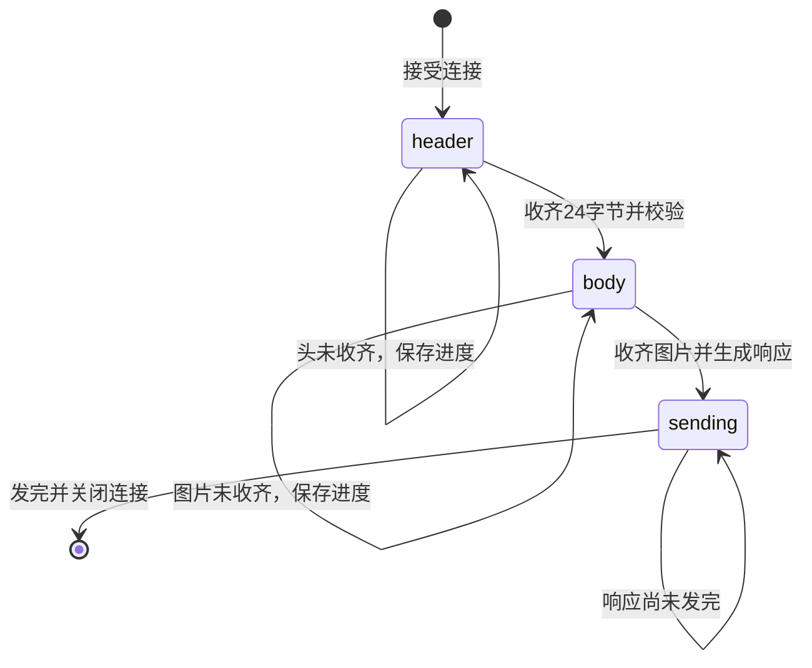

# 第八模块：非阻塞 TCP、epoll 与连接状态

## 1. 本课目标与动手安排

开课时你的熟悉程度为：**完全不了解非阻塞 I/O 和 epoll**。本课从实现原理开始讲解。

**2026-10-04 完成记录：**你已提供普通请求及 A/B 两连接交错处理的成功输出，并正确解释 EAGAIN、跨事件状态保存、部分发送与事件循环等待。补充 EOF 和空闲计时边界后，本课实践与理解检查通过。以下保留完整讲义供查阅，未展示的退出码、超时及异常分支不记为已验证。

模块 7 已由你运行成功，并在补充解释后确认理解。本课复用已有 VFLW 协议和图像处理算法，新增一个持续监听的多连接入口。在一次连接只处理一个图片请求、回一个 JSON 后关闭连接的约定下，服务端可以继续接受其他客户端。

要完成的能力：

- 某条连接只来了半个消息头时，先记住进度，继续处理其他连接。
- 有新的字节到达时，找到对应连接，从上次位置继续接收。
- 收齐并校验头，再按合法长度接收图片体；收齐图片后生成原来的 JSON。
- 响应暂时发不完时，保留未发送部分，等可写通知后继续。
- 请求未收齐就结束发送、网络失败、长时间没有收发进展时，清理这条连接，继续服务其他连接。

**本课采用单线程事件循环和水平触发 epoll。** 图片解码和算法仍在事件循环线程内执行；多个连接可以交错推进 I/O，图像计算还没有并行化。计算耗时较长时，其他连接仍会延后，这部分到模块 9 再解决。

本课参数固定：监听 127.0.0.1:19090；每次接收或发送最多 64 KiB；最多保留 8 条活动连接；10 秒无收发进展关闭；epoll 每次等待最长 200 毫秒。算法继续使用 lane_lines、最多 3 条线段；请求体上限仍为 16 MiB，响应总长上限仍为 64 KiB。

**教学分工：老师准备本讲义和 CMake 配套，你按讲义亲手修改主要代码并运行。** 下面保留完整示例和动手步骤供查阅，无需因讲义仍列出步骤而重新抄写。老师没有生成主要源码，也没有配置、构建、运行或测试本课；本课完成依据是你提供的运行反馈和理解检查。

## 2. 为什么已经能收发，还要改变执行方式

设 A、B 是两个不同客户端。A 只发了 24 字节头部中的前 10 字节，随后暂停；B 已经发送了完整请求。

旧服务端会这样执行：

```text
接受 A → recv_exact 收头 → 已收 10 字节 → 等剩余 14 字节
                                              ↓
                                    当前线程停在 recv 里面
```

即使给旧 main 加一个“重复 accept”的外层循环，当前这一轮也会先等 A 的剩余字节、处理 A、回响应，之后才轮到下一个客户端。这仍然是顺序服务。

本课希望改成：

```text
A 有数据 → 接收 10 字节 → 保存 A.header_done=10 → 返回
B 有数据 → 接收并处理 B → 回传 B 的结果
A 再有数据 → 从 A 的下标 10 继续接收
```

这里包含三个配合的部分：

| 部分 | 解决什么问题 |
| --- | --- |
| 非阻塞套接字 | 当前不能收发时，让调用返回，不在这个连接上等待 |
| epoll | 告诉事件循环哪些套接字现在有可处理的事件 |
| Connection 状态 | 函数返回后，仍记住每个连接已经做到哪里 |

只把 socket 设成非阻塞，不会自动保存进度；只使用 epoll，也不会自动解析 VFLW。我们要把三部分连起来写。

## 3. “非阻塞”怎样体现在返回值上

### 3.1 同一次 recv，等待方式改变

新代码仍调用 Linux 的 recv，不需要换一种协议或图片格式。

| 接收时的情况 | 阻塞套接字 | 非阻塞套接字 |
| --- | --- | --- |
| 当前有字节可读 | 返回本次取得的正字节数 | 同样返回正字节数 |
| 当前没有字节，对端仍可能继续发送 | 可能等待 | 返回 -1，errno 为 EAGAIN 或 EWOULDBLOCK |
| 对端结束发送，已无剩余可读字节 | 返回 0 | 返回 0 |
| 其他接收错误 | 返回 -1，检查 errno | 同样检查 errno |

因此 **EAGAIN 表示“当前做不了，稍后再来”**；它既不表示收到 0 字节，也不表示整条请求失败。这个返回值约定见 [Linux recv 手册](https://man7.org/linux/man-pages/man2/recv.2.html)。

本课遇到 EAGAIN 时保存原来的进度并 return，回到事件循环处理别的连接。下一次通知到来，再调用这条连接的 read_step。

对于 EINTR，本课也先 return；进度没有改变，水平触发模式允许之后继续尝试。其他错误则抛异常，关闭出错连接。

### 3.2 为什么不能直接复用 recv_exact、send_all

模块 7 的 recv_exact 只有“收满后返回”或“异常退出”两种完成方式。它不知道外部事件循环，也没有把半成品进度保存到 Connection。

直接拿它读非阻塞连接，遇到 EAGAIN 会进入它原本的错误分支。如果把 EAGAIN 改成无条件重试，当前线程又会不断调用 recv，形成空转，依然不能服务其他连接。

本课新增 read_step 和 write_step。它们每次至多做一次系统收发，把进度保存在 Connection 中。旧完整收发函数继续留给旧阻塞服务端，不改其行为。

### 3.3 非阻塞模式怎样设置

```cpp
void set_nonblocking(int fd) {
    const int flags = ::fcntl(fd, F_GETFL, 0);
    check_call(flags, "读取套接字状态失败");
    check_call(::fcntl(fd, F_SETFL, flags | O_NONBLOCK),
               "设置非阻塞模式失败");
}
```

fcntl 用来查询或修改描述符相关的属性。这两次调用依次做：

| 调用参数 | 含义 |
| --- | --- |
| fd | 操作哪一个描述符 |
| F_GETFL | 读取现有文件状态标志 |
| 查询时的 0 | 此命令不需要第三个参数的选项值 |
| F_SETFL | 更新文件状态标志 |
| flags \| O_NONBLOCK | 保留现有标志，并启用非阻塞位 |

F_GETFL 成功返回现有标志，可能为 0 或其他非负整数；失败返回 -1。F_SETFL 成功返回 0、失败返回 -1，所以两者都可以用 check_call 的“负数表示失败”检查。

`|` 是按位或。把两个整数的位合并，不是比较，也不是逻辑上的 `||`。假设现有标志为二进制 0010，要开启的某一位为 0100，合并结果是 0110。此处数字仅解释运算，不是 O_NONBLOCK 的实际数值。

读出原 flags 再合并，能保留已有的可设置标志；不能把状态值全部覆盖成随意的整数。接口约定见 [Linux F_GETFL/F_SETFL 手册](https://man7.org/linux/man-pages/man2/F_GETFL.2const.html)。

我们既设置 listener，也设置每次 accept 得到的已连接套接字。**Linux 的 accept 不会自动让新连接继承监听套接字的 O_NONBLOCK。** 这个细节见 [Linux accept 手册](https://man7.org/linux/man-pages/man2/accept.2.html)。

## 4. epoll 怎样告诉我们“可以继续了”

### 4.1 由系统维护关注列表

你先向内核登记“我关注哪些描述符，以及什么事件”，之后调用 epoll_wait 取得就绪事件。它不会替我们调用 recv，也不会直接把图片塞进 body。

本课的流程是：

```text
创建 epoll 实例
    ↓
把 listener 登记进去：关注有连接可接受
    ↓
等待通知
    ├─ listener 就绪 → accept → 登记新连接，关注读取
    ├─ 某连接可读 → 推进该连接的头或体
    └─ 某连接可写 → 推进该连接的响应
    ↓
检查空闲时间 → 再次等待
```

### 4.2 本课为何选水平触发

默认的水平触发，简称 LT，表示就绪条件仍然存在时，后续等待仍可能报告它。例如接收缓冲区里还有字节，哪怕本轮只读了一部分，下一轮仍可以获得读取通知。

本课没有设置 EPOLLET，因此可以每轮只接收最多 64 KiB，把机会留给同一批里的其他连接。边缘触发 ET 有不同的继续读取要求，不能在本例中只加一个 EPOLLET 就认为完成改造。本课先掌握 LT；相关语义见 [Linux epoll 概述](https://man7.org/linux/man-pages/man7/epoll.7.html)。

### 4.3 三个主要接口

| 接口 | 参数在本课中是什么 | 成功返回 | 失败返回 |
| --- | --- | --- | --- |
| epoll_create1 | 创建选项 | 新的 epoll 描述符 | -1，并设置 errno |
| epoll_ctl | epoll 描述符、登记操作、目标 fd、事件结构 | 0 | -1，并设置 errno |
| epoll_wait | epoll 描述符、结果数组、数组容量、最长等待毫秒数 | 就绪条目数量，超时可为 0 | -1，并设置 errno |

监听 socket、已连接 socket、epoll 实例都是不同资源。epoll_fd 用于管理通知，连接 fd 才用于收发。别把这两个整数交换。

### 4.4 需要认识的事件标志

| 标志 | 在本课如何使用 |
| --- | --- |
| EPOLLIN | listener 上可尝试 accept；连接上可尝试接收 |
| EPOLLOUT | 可尝试发送输出缓冲区 |
| EPOLLRDHUP | 对端结束了发送方向，仍要检查已到达的数据 |
| EPOLLERR | 网络错误，结束这条连接 |
| EPOLLHUP | 挂断；接收阶段先尝试取出已缓冲的数据 |

这些标志能组合出现，要用 `flags & EPOLLIN` 等按位与来检查，不能假设每次只发生一个事件。返回的可读通知也可能最终读到 EOF；仍以 recv 的实际返回值判断。

EPOLLERR、EPOLLHUP 不需要显式加入关注掩码，也能被报告。头收齐不等于体收齐，可读通知也不等于一条请求完整。各事件定义见 [Linux epoll_ctl 手册](https://man7.org/linux/man-pages/man2/epoll_ctl.2.html)。

## 5. 文件分工与本课实现顺序

全部操作都在 `/home/rikanshin/VisionFlow/VisionFlow_learn`。

| 文件 | 谁动手 | 本课的具体工作 |
| --- | --- | --- |
| include/tcp_io.hpp | 你 | 增加 SocketFd 移动构造声明 |
| src/tcp_io.cpp | 你 | 实现移动构造，析构只关闭有效描述符 |
| apps/vision_epoll_server.cpp | 你 | 新建完整事件循环入口 |
| python/epoll_observe.py | 你 | 新建两连接观察脚本 |
| CMakeLists.txt | 老师 | 加条件式 vision_epoll_server 目标 |
| lessons/lesson8/08-1-nonblocking-epoll.md | 老师 | 本讲义 |
| README.md、HANDOFF.md | 老师 | 记录当前进度和教学边界 |

现有 apps/vision_server.cpp、python/vision_client.py、协议与算法继续使用。新旧服务端占用同一个端口，实践时只启动其中一个。

实现顺序是资源转移 → 新入口完整代码 → 对照逐段解释 → 写观察脚本 → 自行配置、构建、运行 → 集中理解检查。本课是一份完整讲义，内部的小节是阅读顺序，不是要求每几行就停下来答题。

## 6. 先让 SocketFd 能把资源交给 Connection

### 6.1 为什么这里需要转移所有权

模块 7 的 connection 是 main 里的局部对象。本课 accept 产生的资源，要从接受连接的局部作用域交给 connections 容器，保留到未来多轮事件。

如果只是复制同一个 fd 到两个都会关闭它的对象，就会重复关闭。需要把“负责关闭这个资源的责任”一起转移，并让原对象变成不持有资源的状态。

本课用 -1 表示移动后的空状态。它只是对象内的状态标记，不是一个成功创建的描述符。

### 6.2 头文件的明确修改位置

打开 `include/tcp_io.hpp`，在下面的声明后面插入一行：

```cpp
explicit SocketFd(int fd);
~SocketFd();
```

要插入：

```cpp
SocketFd(SocketFd&& other) noexcept;
```

因此类的 public 开头变成：

```cpp
public:
    explicit SocketFd(int fd);
    ~SocketFd();
    SocketFd(SocketFd&& other) noexcept;

    SocketFd(const SocketFd&) = delete;
    SocketFd& operator=(const SocketFd&) = delete;

    int get() const { return fd_; }
```

保留你的现有注释、私有成员和完整收发函数声明。这里没有要求重写整个头文件，也没有提供移动赋值，因为本例只用移动构造。

`SocketFd&&` 是右值引用，允许构造函数从待转移的对象取得资源。`noexcept` 表示本函数不抛异常；这里只转移整数，确实不需要抛异常。

### 6.3 源文件的明确修改位置

打开 `src/tcp_io.cpp`，在已有 include 中加入：

```cpp
#include <utility>
```

在已有普通构造函数结束后、析构函数之前插入：

```cpp
SocketFd::SocketFd(SocketFd&& other) noexcept
    : fd_(std::exchange(other.fd_, -1)) {}
```

把原析构函数：

```cpp
SocketFd::~SocketFd() {
    ::close(fd_);
}
```

替换为：

```cpp
SocketFd::~SocketFd() {
    if (fd_ >= 0) {
        ::close(fd_);
    }
}
```

`std::exchange(other.fd_, -1)` 做两件事：返回 other.fd_ 的旧值，再把 other.fd_ 写成 -1。返回的旧值用于初始化新对象的 fd_。

假设原对象拥有 fd=7：

| 时刻 | 原对象 fd_ | 新对象 fd_ | 谁负责关闭 7 |
| --- | --- | --- | --- |
| 转移之前 | 7 | 尚未构造 | 原对象 |
| 移动构造之后 | -1 | 7 | 新对象 |
| 原对象离开作用域 | -1 | 7 | 原对象跳过 close |
| 新对象销毁 | 已销毁 | 7 | 新对象调用 close(7) |

以后写 `std::move(accepted)` 是让程序选择这份移动构造；std::move 本身不会创建新的 socket，也不会自动关闭旧描述符。真正转移发生在刚写出的构造函数里。

recv_exact 和 send_all 的实现无需改动。普通构造仍拒绝负 fd；只有成功资源被移动走后，原对象才允许保留 -1。

## 7. 新服务端的完整代码

由你新建 `apps/vision_epoll_server.cpp`，写入下面的完整内容。代码较长，因为这里把连接状态、接收、发送和事件循环集中在一个教学入口；第 8～15 节逐段解释“具体如何做到”。

不要把它追加到旧 vision_server.cpp，也不要把后文的摘录再次追加到文件里。


```cpp
#include "processor.hpp"
#include "protocol.hpp"
#include "tcp_io.hpp"

#include <algorithm>
#include <array>
#include <cerrno>
#include <chrono>
#include <cstdint>
#include <exception>
#include <iostream>
#include <stdexcept>
#include <string>
#include <system_error>
#include <unordered_map>
#include <utility>
#include <vector>
#include <arpa/inet.h>
#include <fcntl.h>
#include <sys/epoll.h>
#include <sys/socket.h>
#include <nlohmann/json.hpp>
#include <opencv2/imgcodecs.hpp>

namespace protocol = visionflow::protocol;
namespace net = visionflow::net;

namespace {

using Clock = std::chrono::steady_clock;
constexpr std::size_t io_chunk = 64U * 1024U;
constexpr std::size_t max_connections = 8;
constexpr auto idle_timeout = std::chrono::seconds(10);
constexpr int wait_timeout_ms = 200;

enum class Phase { header, body, sending };

struct Connection {
    explicit Connection(net::SocketFd&& accepted)
        : socket(std::move(accepted)) {}

    net::SocketFd socket;
    Phase phase = Phase::header;
    std::array<std::uint8_t, protocol::header_size> header_bytes{};
    std::size_t header_done = 0;
    protocol::Header header{};
    std::vector<std::uint8_t> body;
    std::size_t body_done = 0;
    std::vector<std::uint8_t> output;
    std::size_t sent = 0;
    Clock::time_point last_progress = Clock::now();
};

using Connections = std::unordered_map<std::uint64_t, Connection>;

void check_call(int result, const char* message) {
    if (result < 0) {
        throw std::system_error(errno, std::generic_category(), message);
    }
}

bool would_block(int error) {
    return error == EAGAIN || error == EWOULDBLOCK;
}

void set_nonblocking(int fd) {
    const int flags = ::fcntl(fd, F_GETFL, 0);
    check_call(flags, "读取套接字状态失败");
    check_call(::fcntl(fd, F_SETFL, flags | O_NONBLOCK),
               "设置非阻塞模式失败");
}

void set_interest(int epoll_fd, int operation, int fd,
                  std::uint64_t token, std::uint32_t interests) {
    epoll_event event{};
    event.events = interests;
    event.data.u64 = token;
    check_call(::epoll_ctl(epoll_fd, operation, fd, &event),
               "更新 epoll 关注事件失败");
}

std::vector<std::uint8_t> make_response(
    const protocol::Header& header,
    const std::vector<std::uint8_t>& body) {
    nlohmann::json response;
    auto response_type = protocol::Type::result;
    std::string error_code = "invalid_image";
    try {
        const cv::Mat image = cv::imdecode(body, cv::IMREAD_COLOR);
        if (image.empty()) {
            throw std::runtime_error("消息体无法解码为图片");
        }
        error_code = "processing_failed";
        auto processor = create_processor("lane_lines", 3);
        const auto result = processor->process(image);
        response = {
            {"request_id", header.request_id},
            {"status", "ok"},
            {"processor", "lane_lines"},
            {"width", result.width},
            {"height", result.height},
            {"channels", result.channels},
            {"edge_pixels", result.edge_pixels},
            {"lines", nlohmann::json::array()}
        };
        for (const auto& line : result.lines) {
            response["lines"].push_back(nlohmann::json::array({
                line[0], line[1], line[2], line[3]
            }));
        }
    } catch (const std::exception& error) {
        response_type = protocol::Type::error;
        response = {
            {"request_id", header.request_id},
            {"status", "error"},
            {"code", error_code},
            {"message", "图片请求处理失败"}
        };
        std::cerr << "图片请求处理失败：" << error.what() << '\n';
    }

    const std::string text = response.dump();
    constexpr std::size_t max_response = 64U * 1024U;
    if (text.size() > max_response - protocol::header_size) {
        throw std::runtime_error("响应内容超过允许上限");
    }
    const std::vector<std::uint8_t> response_body(text.begin(), text.end());
    return protocol::packet(response_type, header.request_id, response_body);
}

void close_connection(int epoll_fd, Connections& connections,
                      std::uint64_t token, const char* reason) {
    const auto it = connections.find(token);
    if (it == connections.end()) {
        return;
    }
    if (::epoll_ctl(epoll_fd, EPOLL_CTL_DEL,
                    it->second.socket.get(), nullptr) < 0) {
        std::cerr << "移除 epoll 关注失败："
                  << std::system_error(errno, std::generic_category()).what()
                  << '\n';
    }
    connections.erase(it);
    std::cout << "连接 " << token << " 已关闭：" << reason << std::endl;
}

void accept_ready(int epoll_fd, int listener_fd,
                  Connections& connections, std::uint64_t& next_token) {
    for (int attempt = 0; attempt < 16; ++attempt) {
        const int fd = ::accept(listener_fd, nullptr, nullptr);
        if (fd < 0) {
            const int error = errno;
            if (would_block(error)) {
                return;
            }
            if (error == EINTR || error == ECONNABORTED) {
                continue;
            }
            throw std::system_error(error, std::generic_category(),
                                    "接受客户端连接失败");
        }
        net::SocketFd accepted(fd);
        if (connections.size() >= max_connections) {
            std::cerr << "连接数已达上限，关闭新连接\n";
            continue;
        }

        const auto token = next_token++;
        try {
            set_nonblocking(accepted.get());
            const auto inserted =
                connections.try_emplace(token, std::move(accepted));
            try {
                set_interest(epoll_fd, EPOLL_CTL_ADD,
                             inserted.first->second.socket.get(), token,
                             EPOLLIN | EPOLLRDHUP);
            } catch (...) {
                connections.erase(inserted.first);
                throw;
            }
            std::cout << "接受连接 " << token
                      << "，当前连接数：" << connections.size() << std::endl;
        } catch (const std::exception& error) {
            std::cerr << "初始化连接失败：" << error.what() << '\n';
        }
    }
}

void read_step(int epoll_fd, std::uint64_t token, Connection& connection) {
    std::uint8_t* destination;
    std::size_t remaining;
    if (connection.phase == Phase::header) {
        destination = connection.header_bytes.data() + connection.header_done;
        remaining = connection.header_bytes.size() - connection.header_done;
    } else {
        destination = connection.body.data() + connection.body_done;
        remaining = connection.body.size() - connection.body_done;
    }

    const auto count = ::recv(connection.socket.get(), destination,
                              std::min(remaining, io_chunk), 0);
    if (count < 0) {
        const int error = errno;
        if (would_block(error) || error == EINTR) {
            return;
        }
        throw std::system_error(error, std::generic_category(),
                                "接收数据失败");
    }
    if (count == 0) {
        throw std::runtime_error("对端结束发送，请求尚未收齐");
    }
    connection.last_progress = Clock::now();
    const auto received = static_cast<std::size_t>(count);

    if (connection.phase == Phase::header) {
        connection.header_done += received;
        std::cout << "连接 " << token << "：消息头进度 "
                  << connection.header_done << "/"
                  << connection.header_bytes.size() << std::endl;
        if (connection.header_done == connection.header_bytes.size()) {
            connection.header = protocol::decode(
                connection.header_bytes.data(), connection.header_bytes.size());
            if (connection.header.type != protocol::Type::image) {
                throw std::runtime_error("服务端只接受图片请求");
            }
            connection.body.resize(connection.header.payload_length);
            connection.phase = Phase::body;
        }
        return;
    }

    connection.body_done += received;
    if (connection.body_done == connection.body.size()) {
        std::cout << "连接 " << token
                  << "：图片已收齐，开始处理" << std::endl;
        connection.output = make_response(connection.header, connection.body);
        connection.phase = Phase::sending;
        connection.last_progress = Clock::now();
        set_interest(epoll_fd, EPOLL_CTL_MOD, connection.socket.get(), token,
                     EPOLLOUT);
    }
}

bool write_step(Connection& connection) {
    const auto remaining = connection.output.size() - connection.sent;
    const auto count = ::send(
        connection.socket.get(),
        connection.output.data() + connection.sent,
        std::min(remaining, io_chunk), MSG_NOSIGNAL);
    if (count < 0) {
        const int error = errno;
        if (would_block(error) || error == EINTR) {
            return false;
        }
        throw std::system_error(error, std::generic_category(),
                                "发送数据失败");
    }
    if (count == 0) {
        throw std::runtime_error("发送数据未取得进展");
    }
    connection.sent += static_cast<std::size_t>(count);
    connection.last_progress = Clock::now();
    return connection.sent == connection.output.size();
}

void expire_idle(int epoll_fd, Connections& connections) {
    const auto now = Clock::now();
    for (auto it = connections.begin(); it != connections.end();) {
        if (now - it->second.last_progress >= idle_timeout) {
            const auto token = it->first;
            ++it;
            close_connection(epoll_fd, connections, token,
                             "10 秒内没有收发进展");
        } else {
            ++it;
        }
    }
}

} // namespace

int main() {
    try {
        net::SocketFd listener(::socket(AF_INET, SOCK_STREAM, 0));
        const int reuse = 1;
        check_call(::setsockopt(listener.get(), SOL_SOCKET, SO_REUSEADDR,
                               &reuse, sizeof(reuse)), "设置地址复用失败");

        sockaddr_in address{};
        address.sin_family = AF_INET;
        address.sin_port = htons(19090);
        address.sin_addr.s_addr = htonl(INADDR_LOOPBACK);
        check_call(::bind(listener.get(),
                          reinterpret_cast<const sockaddr*>(&address),
                          sizeof(address)), "绑定监听地址失败");
        check_call(::listen(listener.get(), 128), "开始监听失败");
        set_nonblocking(listener.get());

        const int epoll_fd = ::epoll_create1(EPOLL_CLOEXEC);
        check_call(epoll_fd, "创建 epoll 实例失败");
        net::SocketFd poller(epoll_fd);
        set_interest(poller.get(), EPOLL_CTL_ADD, listener.get(), 0, EPOLLIN);

        Connections connections;
        std::uint64_t next_token = 1;
        std::array<epoll_event, 32> events{};
        std::cout << "epoll 服务端正在监听 127.0.0.1:19090，"
                     "持续接受图片请求……" << std::endl;

        while (true) {
            int ready = ::epoll_wait(
                poller.get(), events.data(), static_cast<int>(events.size()),
                wait_timeout_ms);
            if (ready < 0) {
                if (errno == EINTR) {
                    ready = 0;
                } else {
                    check_call(ready, "等待 epoll 事件失败");
                }
            }
            for (int i = 0; i < ready; ++i) {
                const auto token = events[i].data.u64;
                const auto flags = events[i].events;
                if (token == 0) {
                    if (flags & (EPOLLERR | EPOLLHUP)) {
                        throw std::runtime_error("监听套接字发生错误");
                    }
                    accept_ready(poller.get(), listener.get(),
                                 connections, next_token);
                    continue;
                }
                const auto it = connections.find(token);
                if (it == connections.end()) {
                    continue;
                }
                try {
                    auto& connection = it->second;
                    if (flags & EPOLLERR) {
                        throw std::runtime_error("连接发生网络错误");
                    }
                    if (connection.phase != Phase::sending &&
                        (flags & (EPOLLIN | EPOLLRDHUP | EPOLLHUP))) {
                        read_step(poller.get(), token, connection);
                    }
                    if (connection.phase == Phase::sending &&
                        (flags & (EPOLLOUT | EPOLLHUP))) {
                        if (write_step(connection)) {
                            close_connection(poller.get(), connections, token,
                                             "响应已发送");
                        } else if (flags & EPOLLHUP) {
                            throw std::runtime_error("对端挂断，响应未发完");
                        }
                    }
                } catch (const std::exception& error) {
                    std::cerr << "连接 " << token
                              << " 处理失败：" << error.what() << '\n';
                    close_connection(poller.get(), connections, token,
                                     "本次连接失败");
                }
            }
            expire_idle(poller.get(), connections);
        }
    } catch (const std::exception& error) {
        std::cerr << "epoll 服务端失败：" << error.what() << '\n';
        return 1;
    }
}
```


## 8. 新出现的头文件、常量和类型

### 8.1 头文件对应哪些工具

| 头文件 | 新入口里提供什么 |
| --- | --- |
| algorithm | std::min，限制本轮收发长度 |
| chrono | steady_clock、时间点、秒数 |
| unordered_map | 连接编号到连接状态的容器 |
| utility | std::move，转移 SocketFd |
| fcntl.h | fcntl、F_GETFL、F_SETFL、O_NONBLOCK |
| sys/epoll.h | epoll_event、epoll_create1、epoll_ctl、epoll_wait、事件标志 |

协议、OpenCV、JSON 仍是已有依赖。本课不需要额外安装一种“epoll 库”；这些接口由当前 Linux 环境提供。

`namespace { ... }` 是匿名命名空间，让这些辅助定义只在本源文件内部使用。`namespace net = visionflow::net` 则仍是已有的名称简写。

### 8.2 四个数量要分清

| 代码中的数字 | 表示什么 | 不同于哪些数字 |
| --- | --- | --- |
| listen 的 128 | 等待接受的连接队列参数 | 不等于本程序同时保存的连接数 |
| max_connections=8 | connections 容器最多保留的连接条数 | 不等于线程数 |
| accept 循环的 16 | 每次处理监听事件最多尝试多少次 accept | 不限制服务端总共接受多少客户端 |
| events 数组的 32 | epoll_wait 一次最多写入的事件条目数 | 不表示每个连接有 32 字节缓冲区 |

`io_chunk=64*1024` 是单次系统收发的字节上限。它不改变请求体最多 16 MiB 的协议限制：大图片可以分很多轮收齐。

`wait_timeout_ms=200` 是一次等待通知的最长毫秒数；`idle_timeout=10秒` 是每条连接无收发进展的限制，后面分别解释。

## 9. Connection 怎样保存未完成的工作

### 9.1 三个阶段各是什么意思

```cpp
enum class Phase { header, body, sending };
```

`enum class` 定义一组有名字的状态，使用时写成 Phase::header 等。它不是自动执行流程的系统功能；是我们检查和修改的一个字段。



请求未完成时遇到 EOF、网络错误或空闲超时，会从当前阶段直接关闭。本课成功或业务错误响应都经过 sending。

### 9.2 每条连接保存自己的哪些数据

| 成员 | 类型 | 保存的内容 |
| --- | --- | --- |
| socket | SocketFd | 本条连接的描述符和关闭责任 |
| phase | Phase | 当前收头、收体还是发响应 |
| header_bytes | 24 元素字节数组 | 已收到的头及待填的空间 |
| header_done | size_t | 已收到多少头字节 |
| header | protocol::Header | 校验后的类型、请求编号和体长 |
| body | 字节 vector | 按合法长度准备的图片字节空间 |
| body_done | size_t | 已收到多少图片体字节 |
| output | 字节 vector | 完整的响应头加 JSON 体 |
| sent | size_t | 已交给系统发送多少响应字节 |
| last_progress | Clock::time_point | 最近有收发进展的时刻 |

普通 accept 后，phase=header，header_done、body_done、sent 都为 0，两个 vector 为空。直到收齐合法头，才分配 body；直到处理完整图片，才生成 output。

这里一个 Connection 只对应一次请求，因此 sent 不需要为第二次请求清零，也没有“发送后重新收头”的分支。持续服务体现在服务端 main 不退出，而不是在同一连接里无限接收请求。

### 9.3 为什么函数 return 之后这些值还在

```cpp
using Connections = std::unordered_map<std::uint64_t, Connection>;
Connections connections;
```

using 为复杂类型起一个别名。unordered_map 根据键找对应的值，本课键是自己分配的 64 位连接编号，值是 Connection。

例如容器里可能同时有：

```text
连接编号1 → A：phase=header，header_done=10
连接编号2 → B：phase=body，body_done=4096
连接编号3 → C：phase=sending，sent=100
```

这个容器创建在 main 的 while 外面，生命周期覆盖全部事件轮次。read_step 的局部变量离开函数会销毁，但 Connection 的字段仍保留在容器里。

`read_step(..., Connection& connection)` 最后的 & 是引用：函数直接修改容器里那份状态，没有复制出另一个 Connection。

### 9.4 std::move 怎样交接 socket

```cpp
explicit Connection(net::SocketFd&& accepted)
    : socket(std::move(accepted)) {}
```

Connection 的构造从传入对象取得资源，并初始化自己的 socket 成员。这里正好调用第 6 节新增的 SocketFd 移动构造。

接受连接时先写：

```cpp
net::SocketFd accepted(fd);
```

资源立即有一个局部所有者。后面插入容器成功后，责任交给其中的 Connection；原 accepted 的 fd_ 变为 -1。若初始化中途失败，当前仍持有资源的对象负责关闭，避免只有一个裸 fd 却没人回收。

## 10. epoll 实例和事件登记

### 10.1 创建实例、管理生命周期

```cpp
const int epoll_fd = ::epoll_create1(EPOLL_CLOEXEC);
check_call(epoll_fd, "创建 epoll 实例失败");
net::SocketFd poller(epoll_fd);
```

epoll_create1 创建内核中的事件通知实例。成功返回非负描述符，失败返回 -1。EPOLL_CLOEXEC 表示后续若执行 exec 替换进程程序，该描述符会关闭；本课不使用 exec，先保留这一资源选项。

poller 用已有的 SocketFd 管理 close。虽然类名带 Socket，这个类当前实际上只保存整数、转移所有权和调用 close，也能管理 epoll 的描述符。我们先用 check_call 提供准确的创建失败消息，再包装成功的描述符。

创建选项不会把连接变成非阻塞，也不会替代对连接的 fcntl 设置。接口和关闭约定见 [Linux epoll_create1 手册](https://man7.org/linux/man-pages/man2/epoll_create1.2.html)。

### 10.2 epoll_ctl 的四个实参

```cpp
void set_interest(int epoll_fd, int operation, int fd,
                  std::uint64_t token, std::uint32_t interests) {
    epoll_event event{};
    event.events = interests;
    event.data.u64 = token;
    check_call(::epoll_ctl(epoll_fd, operation, fd, &event),
               "更新 epoll 关注事件失败");
}
```

| epoll_ctl 实参 | 本例的意思 |
| --- | --- |
| epoll_fd | 修改哪一份 epoll 关注列表 |
| operation | ADD 新增、MOD 修改、DEL 删除 |
| fd | 要关注的监听或连接描述符 |
| &event | 传入事件选项和我们希望带回的标识 |

epoll_event 中 events 放事件位掩码，data.u64 放一份 64 位自定义数据。登记时系统保存这些值，返回事件时把标识一起交给我们；这里不要求局部 event 对象一直存活。

本课约定 token=0 表示监听套接字；新连接编号从 1 递增。编号来自 next_token，不是 Linux fd，也不是 VFLW request_id。例如连接编号 5 内部可以保存 fd=7，同时请求头的 request_id=42。

为什么不只用 fd 找状态？关闭旧连接后，Linux 可能把同一个 fd 数字分配给新连接；本例用新的连接编号识别新资源，已删除编号的旧事件会被跳过。在本课的运行范围内编号持续递增，不复用。

事件数据和登记操作的定义见 [epoll_ctl 手册](https://man7.org/linux/man-pages/man2/epoll_ctl.2.html)。

### 10.3 三次登记对应三个时机

```cpp
// 初始登记监听入口，0 是本课保留的监听标识
set_interest(poller.get(), EPOLL_CTL_ADD, listener.get(), 0, EPOLLIN);

// 接受客户端后，关注它的读取和发送方向结束
set_interest(epoll_fd, EPOLL_CTL_ADD, fd, token,
             EPOLLIN | EPOLLRDHUP);

// 收齐请求并生成响应后，切换成关注写入
set_interest(epoll_fd, EPOLL_CTL_MOD, fd, token, EPOLLOUT);
```

以上是阅读摘录，完整程序从 Connection 中取得 fd，不要再次追加。

注意 MOD 是用新的关注组合替换当前组合。发送阶段没有继续登记 EPOLLIN、EPOLLRDHUP，因为本课只发回一次结果后关闭，不接收第二个请求。

我们不从连接刚建立时就持续关注 EPOLLOUT。很多时候连接立即可写，如果没有任何响应待发送却一直收到可写通知，循环可能反复空转。只有 output 准备好后才启用写通知。

## 11. accept_ready：一次监听通知可以接入多条连接

### 11.1 非阻塞 accept 什么时候返回

main 把 listener 也设置成非阻塞。监听事件出现后，我们尝试 accept，队列里还有连接就继续取，队列暂时空了则遇到 EAGAIN/EWOULDBLOCK 并 return。

本次最多尝试 16 次，避免不断有新连接时一直停留在接入函数。采用 LT 时，队列仍有连接会在后续继续得到监听事件。

EINTR 表示中断，ECONNABORTED 表示待接受连接中止，本例继续下一次尝试；其余接入错误上报外层 main。监听资源或 epoll 机制发生故障属于服务端整体错误；普通连接的错误稍后会单独隔离。

### 11.2 连接上限与局部对象的析构

```cpp
net::SocketFd accepted(fd);
if (connections.size() >= max_connections) {
    std::cerr << "连接数已达上限，关闭新连接\n";
    continue;
}
```

一旦拿到有效 fd 就先包装。活动连接已达 8 条时，本次 accepted 离开循环体作用域，其析构关闭这个新 fd。现有 8 条连接继续工作。

这一上限限制保存的连接数；具体体长仍由协议校验。更完整的内存预算和背压在模块 9 讨论，本课不提前实现。

### 11.3 try_emplace、pair 和异常回滚

```cpp
const auto inserted =
    connections.try_emplace(token, std::move(accepted));
```

try_emplace 用键 token 在容器里直接构造 Connection，把后面的参数传给它的构造函数。它返回一对值：

- inserted.first：指向该条目的迭代器。
- inserted.second：是否插入了新条目。

本例使用递增的新 token，因此没有重复键。迭代器可写 `inserted.first->second` 取得 Connection；容器条目的 first 是键，second 是值。

条目插入后还要 epoll_ctl ADD 登记。若登记失败，内部 catch(...) 删除刚插入的条目，再把异常重新抛出：

```cpp
catch (...) {
    connections.erase(inserted.first);
    throw;
}
```

catch(...) 能捕获任意异常类型；裸 throw 继续传递当前异常。删除条目会销毁 Connection，关闭其 socket，避免留下一个保存在容器中却没有登记的连接。

外围 catch 显示初始化失败，然后监听函数可以继续接受其他连接。std::move 和立即包装资源，让插入分配失败或登记失败时仍能按当前所有者清理。

## 12. read_step：每次推进一点，状态留到下一轮

### 12.1 先根据阶段找到下一块可写内存

```cpp
if (connection.phase == Phase::header) {
    destination = connection.header_bytes.data() + connection.header_done;
    remaining = connection.header_bytes.size() - connection.header_done;
} else {
    destination = connection.body.data() + connection.body_done;
    remaining = connection.body.size() - connection.body_done;
}
```

事件循环只在尚未进入 sending 时调用 read_step，所以这里的 else 就对应 body。

destination 是本次写入起点，remaining 是剩余空间。它们与模块 7 的 data+done、size-done 同一原理，区别是 done 现在保存在每个 Connection 内。

```cpp
const auto count = ::recv(connection.socket.get(), destination,
                          std::min(remaining, io_chunk), 0);
```

四个参数依次是连接 fd、内存起点、本轮最大字节数、普通接收标志。std::min 取较小值，例如剩余 100000、io_chunk=65536，本次最多取 65536；剩余只有 14 就只能取 14。

系统可能返回少于这份上限的正字节数，代码只累加实际取得的 count。这里不循环等到全部收到。

### 12.2 返回值决定“返回等待”还是“结束连接”

```cpp
if (count < 0) {
    const int error = errno;
    if (would_block(error) || error == EINTR) {
        return;
    }
    throw std::system_error(error, std::generic_category(),
                            "接收数据失败");
}
if (count == 0) {
    throw std::runtime_error("对端结束发送，请求尚未收齐");
}
```

把 errno 先保存到 error，避免后续操作覆盖错误原因。

EAGAIN/EWOULDBLOCK：没有修改 header_done/body_done，没有关闭连接，直接返回。下次事件再读同一个未完成位置。

EOF：当前还在接收必需数据，请求无法补齐，所以抛异常，由连接级 catch 清理。正数才会转换为 size_t，防止负返回值变成巨大的无符号数字。

### 12.3 24 字节头分三轮接收的状态变化

假设实际读到 10、8、6 字节，这组数用于解释，不是老师的运行记录：

| 事件轮次 | 调用前 header_done | recv 起点 | 本轮最多接收 | 假设 count | 调用后阶段 |
| --- | --- | --- | --- | --- | --- |
| 第 1 次 | 0 | header_bytes+0 | 24 | 10 | header，done=10 |
| 第 2 次 | 10 | header_bytes+10 | 14 | 8 | header，done=18 |
| 第 3 次 | 18 | header_bytes+18 | 6 | 6 | 校验后变为 body |

每一行 read_step 都会返回，事件循环可以在两行之间处理其他连接。只要你不重新创建 Connection，前面填好的字节就还在。

如果中间某次返回 EAGAIN，状态停在原来的 done 数值，不会向前增加，也不会归零。

### 12.4 收齐头以后才创建体缓冲区

```cpp
connection.header = protocol::decode(
    connection.header_bytes.data(), connection.header_bytes.size());
if (connection.header.type != protocol::Type::image) {
    throw std::runtime_error("服务端只接受图片请求");
}
connection.body.resize(connection.header.payload_length);
connection.phase = Phase::body;
```

decode 仍是模块 6 已完成的内存解释和校验，不执行网络接收。它默认拒绝空体及超过 16 MiB 的体。类型检查通过后，resize 把 body 的实际大小设为合法体长。

例如声明体长 100000，resize 创建 100000 个字节元素，body_done 仍为 0。下一次读就会写到 body.data()，不是再写到头里。

头收满后当前函数立即 return。若图片字节已在系统缓冲区，LT 模式会让后续循环继续获得可读事件，所以我们不需要在同一次调用中强行收完图片。

### 12.5 图片体收齐前后

假设体长 100000，第一轮取得 65536，第二轮取得剩余 34464：

| 时刻 | body_done | 下一写入位置 | 剩余长度 |
| --- | --- | --- | --- |
| 刚建立 body | 0 | body.data() | 100000 |
| 第一轮后 | 65536 | body.data()+65536 | 34464 |
| 第二轮后 | 100000 | 不再接收本次体 | 0 |

只有 body_done==body.size() 才调用 make_response。它复用模块 7 的 imdecode、lane_lines、JSON 和 packet 流程，将业务错误也封装成响应。

随后：

```cpp
connection.output = make_response(connection.header, connection.body);
connection.phase = Phase::sending;
connection.last_progress = Clock::now();
set_interest(epoll_fd, EPOLL_CTL_MOD, connection.socket.get(), token,
             EPOLLOUT);
```

这里 output 保存整个响应，sent 初始仍为 0，之后从响应的第一个字节发起。阶段与关注事件一起切换，后续通知由写入函数处理。

make_response 不做网络收发。如果 image 无法解码，它返回 type=error 的合法响应；头校验失败、体未收齐等则在进入此函数前就结束连接，与模块 7 的业务边界一致。

## 13. write_step：响应没有发完时怎样保留

```cpp
const auto remaining = connection.output.size() - connection.sent;
const auto count = ::send(
    connection.socket.get(),
    connection.output.data() + connection.sent,
    std::min(remaining, io_chunk), MSG_NOSIGNAL);
```

它从尚未发送位置取字节，单次最多交付 64 KiB。MSG_NOSIGNAL 仍用于避免断开的连接触发 SIGPIPE 直接终止进程。非阻塞发送暂时不能继续时可返回 EAGAIN/EWOULDBLOCK；这些约定见 [Linux send 手册](https://man7.org/linux/man-pages/man2/send.2.html)。

假设整条响应 224 字节、第一次 send 返回 100：

```text
output：[已交付的100字节][尚未交付的124字节]
sent = 100
下次起点 = output.data() + 100
下次最大长度 = 124
```

进度保存在 connection.sent。若下一次 EAGAIN，sent 仍为 100，write_step 返回 false。事件循环保留连接和 output，等待之后的 EPOLLOUT。

| write_step 结果 | 事件循环如何处理 |
| --- | --- |
| false，未抛异常 | 本轮未发完，保留连接 |
| true | 全部交给系统，清理这条连接 |
| 抛异常 | 记录失败，清理这条连接 |

false 包括“本轮没有空间”和“成功发送了部分内容”，都不是“立刻关闭”。正常返回 true 仍表示完成向系统交付，客户端是否解析成功要看客户端输出。

本课只在 sending 阶段调用它，output 一定非空，且一旦发送完就关闭，因此没有 size=0 的正常发送调用。

## 14. main 的事件循环怎样调度不同连接

### 14.1 epoll_wait 把结果写进数组

```cpp
std::array<epoll_event, 32> events{};
int ready = ::epoll_wait(
    poller.get(), events.data(), static_cast<int>(events.size()),
    wait_timeout_ms);
```

| 实参 | 含义 |
| --- | --- |
| poller.get() | 从哪个 epoll 实例取得通知 |
| events.data() | 通知写入哪个数组 |
| static_cast<int>(events.size()) | 本次数组可容纳 32 条，接口要求 int |
| wait_timeout_ms | 没有就绪事件时最多等待 200 毫秒 |

ready>0 时，只遍历下标 0 到 ready-1。这轮未填的新数组位置不能当作通知使用。ready=0 表示本次没有事件，仍要检查超时。-1 时，EINTR 本例按本轮没有事件处理并继续检查时间，其他失败结束服务端。

**epoll_wait 仍可以等待。** 本课把等待集中在这里：等待期间任何一个被关注连接就绪，都能使循环返回；recv/send 不再为了某一条连接停住。没有通知时，循环也无需不断扫描所有 socket 来尝试收发。接口定义见 [Linux epoll_wait 手册](https://man7.org/linux/man-pages/man2/epoll_wait.2.html)。

### 14.2 从事件找到 Connection

```cpp
const auto token = events[i].data.u64;
const auto flags = events[i].events;
```

token 是登记时放进去的标识，flags 是这次实际发生的事件位组合。先复制到局部变量，再使用它们。

token=0 就去处理监听入口；其他编号查容器：

```cpp
const auto it = connections.find(token);
if (it == connections.end()) {
    continue;
}
auto& connection = it->second;
```

find 找不到时返回 end，不是返回一个可用 Connection。可能有旧事件对应已删除的连接，所以先判断再访问。it->first 是连接编号，it->second 才是连接状态。

### 14.3 位掩码、逻辑条件与阶段

```cpp
if (connection.phase != Phase::sending &&
    (flags & (EPOLLIN | EPOLLRDHUP | EPOLLHUP))) {
    read_step(poller.get(), token, connection);
}
```

从括号内往外看：

1. `EPOLLIN | EPOLLRDHUP | EPOLLHUP` 合成“任一相关读取／结束事件”的掩码。
2. flags 与这个掩码按位与，结果非零说明至少出现了一种。
3. `&&` 再要求当前尚未进入 sending。
4. 两者成立才推进接收。

下一段检查 sending 以及 EPOLLOUT/EPOLLHUP，再调用 write_step。read_step 可能已经切换阶段，所以第二个 if 读取的是更新后的 phase；如果这轮没有对应写标志，就等下次通知，不强行发送。

### 14.4 半关闭为什么不能一看到就丢弃数据

EPOLLRDHUP 表示对端停止发送，已送入系统的头和图片字节仍可能没有被本程序取完。我们先调用 read_step，继续按状态接收；直到需要数据时 recv 返回 0，才判定请求没有收齐。

如果客户端发送完整请求后只关闭自己的发送方向，服务端仍有机会读全请求并回响应。进入 sending 后不继续关注 RDHUP，避免对端停止发送的通知干扰这份发送状态。

EPOLLHUP 也可能伴随尚未读取的数据，接收阶段同样先读取。发送阶段遇到挂断，尝试一次写入；未发完就按失败清理。EPOLLERR 则直接走连接错误分支。

### 14.5 一条连接失败为什么不终止全部服务

事件处理中有一层连接级 try/catch。头不合法、体提前结束、网络收发失败等，都记录当前 token，并调用 close_connection，之后继续本批其他通知。

main 最外层 catch 针对无法继续维持服务的错误，例如绑定失败、epoll_wait 失败或监听资源错误。

make_response 内还有业务级 try/catch，负责将图片处理失败变成错误 JSON。三个边界是：

| 边界 | 处理方式 |
| --- | --- |
| 图片业务错误 | 构造错误响应，进入发送 |
| 某条连接错误 | 关闭该连接，服务端继续 |
| 服务端基础资源错误 | main 返回 1，结束服务 |

### 14.6 清理时先取消关注，再销毁状态

```cpp
::epoll_ctl(epoll_fd, EPOLL_CTL_DEL, fd, nullptr);
connections.erase(it);
```

DEL 的最后一个参数不需要事件结构，所以用 nullptr。这里取消关注，然后 erase 销毁 Connection，SocketFd 析构关闭 fd。

如果取消关注失败，代码显示系统原因，仍删除状态并关闭资源。本例没有复制描述符；关闭也会释放该资源在内核中的关联，但代码仍明确表达正常的取消登记顺序。

发送完调用 close_connection 后，那份 connection 引用就不能继续使用。完整程序在该分支后不再访问它。旧 token 再出现在事件数组中时，find 检查会跳过。

## 15. 空闲超时怎样实现

### 15.1 使用时间差，不使用墙上日期

```cpp
using Clock = std::chrono::steady_clock;
Clock::time_point last_progress = Clock::now();
```

steady_clock 用于计算经过的时间，不随手动调整系统日期来回跳变。time_point 是这个时钟中的时间点，两个时间点相减得到 duration，也就是持续时长。

每次 recv/send 取得正进展都刷新 last_progress；准备好响应时也更新一次，给发送阶段重新计时。EAGAIN、EINTR 没有完成收发，不刷新进度时间。

例如某连接最后一次取得字节是在 12.0 秒，当前时间点是 22.3 秒：

```text
当前时间 - last_progress = 10.3 秒
10.3 秒 >= 10 秒 → 关闭该连接
```

它是“连续无进展超时”，不是整张图片必须在 10 秒内收完。只要持续有正收发进展，计时会刷新。

### 15.2 200 毫秒等待与 10 秒空闲是两层机制

epoll_wait 的 200 毫秒保证没有任何通知时，循环也会周期性醒来；返回后 expire_idle 才逐条检查 10 秒的限制。

它不意味着 200 毫秒就关闭连接。单独把 epoll_wait 设成 200，也不会自动清除空闲连接，清理逻辑是我们写的。

即使这一轮 ready>0，也会在处理本批通知后执行扫描，不能只在 ready=0 时检查，否则其他连接不断活跃时，空闲连接可能一直不被清理。

扫描和实际关闭发生在事件循环获得执行机会时；图像计算和系统调度可能造成延迟。因此这里没有“精确到第 10 秒立即关闭”的保证，也没有定时器线程。

### 15.3 遍历时删除，为什么先 ++it

```cpp
const auto token = it->first;
++it;
close_connection(epoll_fd, connections, token, "10 秒内没有收发进展");
```

erase 会让被删除条目的迭代器失效。先记住 token，再把遍历位置移到下一个条目，然后删除旧条目，就不用在失效迭代器上做 ++。

本例关闭单条连接不会使其他 unordered_map 条目的迭代器失效，所以可以继续遍历。

## 16. 两连接观察脚本的完整内容

由你新建 `python/epoll_observe.py`，写入下面内容。这段脚本集中观察本课最重要的行为：**A 请求尚未完整时，B 是否能先取得结果；A 后续是否能继续完成。**

只用一个 Python 进程，但持有两个独立连接。无需预先学习线程池。


```python
import json
import socket
import struct
import sys
from pathlib import Path

from vision_client import HEADER, recv_exact


def request(jpeg, request_id):
    return HEADER.pack(b"VFLW", 1, 1, request_id, len(jpeg), 0) + jpeg


def show_response(connection, request_id, label):
    header = recv_exact(connection, HEADER.size)
    magic, version, kind, response_id, length, flags = HEADER.unpack(header)
    if magic != b"VFLW" or version != 1 or flags != 0:
        raise ValueError("响应消息头格式不正确")
    if kind not in (2, 3) or response_id != request_id:
        raise ValueError("响应类型或编号不正确")
    if not 0 < length <= 64 * 1024 - HEADER.size:
        raise ValueError("响应长度超出允许范围")
    result = json.loads(recv_exact(connection, length).decode("utf-8"))
    expected_status = "ok" if kind == 2 else "error"
    if not isinstance(result, dict):
        raise ValueError("响应 JSON 必须是对象")
    if result.get("request_id") != request_id:
        raise ValueError("JSON 请求编号不一致")
    if result.get("status") != expected_status:
        raise ValueError("响应类型与 JSON 状态不一致")
    print(f"{label}收到响应：编号={response_id}，状态={result['status']}")
    if kind != 2:
        raise RuntimeError("本次图片处理失败")


def main():
    jpeg = Path("samples/frame.jpg").read_bytes()
    if not 0 < len(jpeg) <= 16 * 1024 * 1024:
        raise ValueError("图片大小必须在 1 字节到 16 MiB 之间")
    address = ("127.0.0.1", 19090)
    slow_request = request(jpeg, 101)
    with socket.create_connection(address, timeout=15) as slow:
        slow.sendall(slow_request[:10])
        print("A 连接只发送了头部的前 10 字节，暂不补齐")
        with socket.create_connection(address, timeout=15) as fast:
            fast.sendall(request(jpeg, 102))
            show_response(fast, 102, "B 连接")
        slow.sendall(slow_request[10:])
        print("A 连接继续发送剩余请求")
        show_response(slow, 101, "A 连接")
    return 0


if __name__ == "__main__":
    try:
        sys.exit(main())
    except (OSError, ValueError, RuntimeError, struct.error) as error:
        print(f"观察失败：{error}", file=sys.stderr)
        sys.exit(1)
```


### 16.1 观察脚本怎样制造两条不同进度的连接

`from vision_client import HEADER, recv_exact` 复用同目录已有客户端的协议格式和接收函数。直接运行本脚本时，Python 能在脚本所在的 python 目录找到 vision_client.py。被导入模块的 `if __name__ == "__main__"` 不成立，所以不会自动执行旧客户端的 main。

本脚本按以下顺序执行：

| 顺序 | 动作 | 此时的关键状态 |
| --- | --- | --- |
| 1 | A 建立连接，只发送 slow_request[:10] | A 只提供了前 10 字节，头尚不完整 |
| 2 | B 建立连接，发送完整图片请求 | A 仍然保持连接，并未补齐 |
| 3 | 等待 B 的响应 | 服务端必须能在 A 未完成时推进 B |
| 4 | 收到 B 的响应后，补发 slow_request[10:] | A 的剩余头和完整图片体现在才发出 |
| 5 | 等待 A 的响应 | 服务端从 A 已有进度继续完成 |

`[:10]` 取下标 0～9 的字节，`[10:]` 取下标 10 到末尾，两段拼起来正好是原请求。它们没有重发前 10 字节，也没有丢掉后面的图片。

A 的 request_id=101，B 的 request_id=102，用来核对两份响应归属。它们与服务端日志中的连接 token 是两套编号。

两个 create_connection 都设置 timeout=15，让观察脚本在异常情况下能报告等待超时。服务端仍使用自己的 10 秒无进展策略；本观察假定当前小样例的处理能在该空闲期限内完成。如果计算特别慢导致 A 超时，应结合服务端日志分析，不能把日志之外的原因直接认定为网络故障。

客户端本身使用阻塞收发没有问题：这一次学习的是服务端怎样同时管理多个连接。脚本有意等 B 返回后才补齐 A，以便从输出判断服务端是否能交错推进。

### 16.2 应当观察什么，不能仅凭什么下结论

关键证据是 **B 的成功响应出现在“A 连接继续发送剩余请求”之前，而且 A 后来也成功**。仅看两条连接都建立成功，不能证明它们都被应用处理。

服务端头部进度日志可能显示 A 的 10/24，后续显示 24/24。事件顺序和每次 recv 的返回长度由实际运行决定，不要求每次日志都按讲义的某种固定顺序出现。

脚本验证消息头、编号、状态和响应长度，失败返回 1。成功说明这次两连接请求配合有效；它不代表所有网络错误或部分发送分支都发生过。

## 17. CMake 配套及文件职责

老师在 CMakeLists.txt 末尾添加了下面的条件式目标。你不需要再次追加；写好入口以及第 6 节的 SocketFd 修改后，由你重新配置。


```cmake
# 模块 8：学生写好新的入口后，再由学生重新配置生成此目标。
if(EXISTS "${CMAKE_CURRENT_SOURCE_DIR}/apps/vision_epoll_server.cpp"
   AND EXISTS "${CMAKE_CURRENT_SOURCE_DIR}/src/tcp_io.cpp"
   AND EXISTS "${CMAKE_CURRENT_SOURCE_DIR}/include/tcp_io.hpp")
    add_executable(vision_epoll_server
        apps/vision_epoll_server.cpp
        src/tcp_io.cpp
        src/protocol.cpp
        src/processor.cpp
        src/line_utils.cpp
    )
    target_include_directories(vision_epoll_server PRIVATE
        ${CMAKE_CURRENT_SOURCE_DIR}/include
        ${OpenCV_INCLUDE_DIRS}
    )
    target_link_libraries(vision_epoll_server PRIVATE
        ${OpenCV_LIBS}
        nlohmann_json::nlohmann_json
    )
endif()
```


上面的目标把新入口和已有 tcp_io、protocol、processor、line_utils 一起编译链接。epoll 接口不需要另加一个 epoll 链接库，OpenCV 和 JSON 仍按原工程配置。

EXISTS 条件让主要入口尚未写入时跳过新目标。它只检查文件存在，不会证明源文件内容完整，也不会证明移动构造已写好。重新执行配置之后，构建系统才会根据当前文件生成 vision_epoll_server 目标。

## 18. 由你执行的集中实践

下面命令都由你在同一个 Ubuntu-20.04 WSL 环境中执行。老师没有执行这些命令；下面的输出是代码推导的预期。

### 18.1 写齐代码并构建

完成以下三项后再构建：

- 按第 6 节修改 include/tcp_io.hpp、src/tcp_io.cpp。
- 按第 7 节写入 apps/vision_epoll_server.cpp。
- 按第 16 节写入 python/epoll_observe.py。

在终端 A：

```bash
cd /home/rikanshin/VisionFlow/VisionFlow_learn
cmake -S . -B build
cmake --build build --target vision_epoll_server -j2
```

配置命令复用现有 build 的生成器和依赖设置。某一步失败时，保留对应命令与完整报错反馈，不需要重抄已经完成的旧课。

### 18.2 启动持续服务端

确认旧 vision_server 已退出，然后在终端 A：

```bash
./build/vision_epoll_server
```

预期出现：

```text
epoll 服务端正在监听 127.0.0.1:19090，持续接受图片请求……
```

这个程序会一直等待连接，处理一个请求后也不退出。终端没有重新出现 shell 提示符，是当前设计的正常行为。后续客户端命令放到终端 B。

### 18.3 先用现有客户端确认原来的协议仍能使用

终端 B：

```bash
cd /home/rikanshin/VisionFlow/VisionFlow_learn
python3 python/vision_client.py samples/frame.jpg
echo $?
```

预期客户端仍得到 request_id=42、status=ok、640×360、3 通道的 lane_lines 结果，最多 3 条线段；成功时退出码为 0。具体算法结果与同一图片、同一算法的已有结果对照。

服务端会显示接受连接、头部进度、图片收齐、响应已发送后的连接关闭消息，随后继续监听。这个入口不保存结果图片或 result.json。

### 18.4 保持同一个服务端运行，执行两连接观察

仍在终端 B：

```bash
python3 python/epoll_observe.py
echo $?
```

预期输出的关键顺序：

```text
A 连接只发送了头部的前 10 字节，暂不补齐
B 连接收到响应：编号=102，状态=ok
A 连接继续发送剩余请求
A 连接收到响应：编号=101，状态=ok
0
```

因为本脚本在收到 B 响应前不会补齐 A，如果服务端仍在阻塞等待 A 的头，就不能按这个顺序成功完成。新服务端应保留 A 的半成品状态，并先推进 B。

你不需要为了这一步重启服务端。先运行原客户端，再运行观察脚本，本身也能观察同一个服务端持续接受后续连接。

### 18.5 可选：观察空闲连接被清理

如果想观察第 15 节，在终端 B 执行：

```bash
python3 - <<'PY'
import socket

with socket.create_connection(("127.0.0.1", 19090), timeout=15) as connection:
    print("已连接，保持空闲，等待服务端关闭")
    data = connection.recv(1)
    print("接收结果：", repr(data))
PY
```

脚本连接后不发送任何请求。服务端在能执行空闲扫描时发现超过 10 秒无进展，将关闭此连接；客户端预期读到空字节串 b''。服务端日志应显示“10 秒内没有收发进展”，而服务端进程继续运行。

这是可选观察，不要求为了进入后续学习补齐所有异常实验。未展示的运行分支不记录为已验证。

### 18.6 结束本次观察

完成后，在终端 A 按 Ctrl+C 停止持续服务端。本课没有安装信号处理函数；默认终止由系统回收进程资源，不能把它说成已经实现了模块 10 的优雅停止，也不能假定所有局部 C++ 对象都按正常 return 路径析构。

## 19. 根据现象定位本课代码

| 现象 | 优先对照的位置 |
| --- | --- |
| 构建提示没有 vision_epoll_server 目标 | 新入口是否存在，写好后是否重新执行 CMake 配置 |
| 提示使用了已删除的 SocketFd 复制构造 | 移动构造声明是否加入正确类内，Connection 是否用了 std::move |
| 链接提示 SocketFd 移动构造未定义 | tcp_io.cpp 是否加了对应定义，签名及 noexcept 是否一致 |
| “绑定监听地址失败”，系统详情为 Address already in use | 是否仍有旧服务端或另一份新服务端占用 19090 |
| 单客户端成功，但 B 一直没有响应 | 是否仍调用 recv_exact 等待 A，已连接 socket 是否设置非阻塞 |
| 只读到头就一直没有后续处理 | phase 是否切换为 body，body 是否按校验后的长度 resize |
| 空闲时循环持续忙碌 | 是否过早关注 EPOLLOUT、是否把 epoll_wait 超时设成 0 |
| 连接很快出现无法解析的头 | 是否保存每条连接自己的 header_done，写入起点是否加了偏移 |
| 客户端报“连接已关闭，尚未收齐消息数据” | 对照服务端同一连接的关闭原因，区分协议失败、空闲超时和发送失败 |
| 一条坏请求导致整个服务退出 | 连接级 try/catch 是否仍在每条事件的处理范围内 |
| 响应发送了一部分就关闭 | write_step 的 false 是否被误解为失败或完成 |
| 老客户端成功一次后无法再连接 | 是否启动了旧 vision_server，而非 vision_epoll_server |

这些是定位入口，不是对未提供输出的预先诊断。发生问题时，把两端输出及相关代码片段一起反馈，我们根据实际证据判断。

## 20. 本知识点的集中理解检查

先完成阅读、动手和集中实践，再用自己的话说明以下四点；不需要逐小节答题。

1. 非阻塞 recv 返回 -1 且 errno=EAGAIN 时，为什么应该返回事件循环？它与 recv 返回 0 有什么区别？
2. A 头部只收到 10 字节后，read_step 已经返回。哪些对象和字段保存这 10 字节及其进度？下一次从哪里继续写？
3. output 共 224 字节，sent=100，随后 send 遇到 EAGAIN。哪些数据要保留，关注哪个事件，下次从哪里继续发送？
4. epoll_wait 最长等待 200 毫秒，连接空闲期限却是 10 秒，这两个数字分别管什么？为什么图像计算很慢时其他连接仍会延迟？

2026-10-04：本课的普通请求与两连接交错观察成功，集中理解检查通过，具体证据见 README.md 和 HANDOFF.md。下一步进入模块 9 的任务队列与线程池，先确认熟悉程度；不重复本课，也不要求补跑可选观察。
