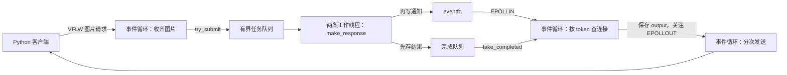

# 模块 9.2：工作线程、完成通知与 epoll 接入

> 状态：2026-10-07 已完成。学生实践成功，老师解释集中问题后，学生明确确认理解。接续 [10-1 Linux 信号与服务端优雅停止](../lesson10/10-1-signals-graceful-stop.md)。本页保留本课教材和历史反馈。

## 1. 当前进度与本课目标

09-1 已完成。你已运行有界队列观察程序并得到退出码 0，解释了提交、所有权和关闭排空；对等锁时间与内存预算的补充也已明确回复“已消化”。本课直接使用现有 ImageTaskQueue，不再重写它。

线程池基础已确认：你了解概念并写过简单线程池。eventfd 是本课新增接口；目前未收到其熟悉程度回答，以下按首次使用提供参数和执行过程说明，之后以你的反馈调整。

当前 epoll 入口收齐图片后，在事件循环里调用 make_response。只要该函数仍在这个线程里执行，解码和图像计算就会延迟其他连接的收发。本课把这一调用交给两条工作线程，同时保留事件循环对连接的独占管理。

学完并实现后应形成完整闭环：

1. epoll 收齐请求，把图片所有权交给有界队列。
2. 工作线程取任务，在队列锁外生成完整 VFLW 响应。
3. 工作线程把结果放入完成队列，写 eventfd 通知。
4. epoll 被唤醒，按 connection_token 查找连接，保存 output，再等待 EPOLLOUT 续发。
5. 队列或未交回任务额度已满时，事件循环返回 busy；已失效连接的结果直接丢弃。

本课仍是一连接一请求一响应，不加入视频流、长连接多请求、信号处理或进程监管。主要源码由你亲手写入并运行；老师只维护讲义、CMake 和进度记录。

## 2. 线程与数据各归谁




| 对象／操作 | 由谁访问 | 为什么 |
| --- | --- | --- |
| connections、Connection、socket 收发、epoll_ctl | 仅事件循环 | 工作线程不持有可能失效的连接引用 |
| ImageTaskQueue | 事件循环提交，工作线程取出 | 已有 mutex 与条件变量负责同步 |
| 正在处理的 ImageTask | 取走它的那条工作线程 | 图片字节由这份任务拥有 |
| 完成队列 completed_ | 工作线程写，事件循环取 | 使用独立的 completed_mutex_ |
| outstanding_ | 仅事件循环 | 只在提交成功与取回结果时计数 |
| fatal_ | 工作线程写，事件循环读 | 使用 atomic<bool> 传递故障状态 |
| eventfd | 工作线程 write，事件循环 read | 只用于唤醒，不承载图片或 JSON |

不要把连接表的 mutex 传给工作线程“解决一切”。本课通过限制谁能访问连接，让连接生命周期与网络状态仍由一个线程管理。

## 3. 两种上限：排队容量与未交回任务数

为便于观察，本课取 **2 条工作线程、排队容量 2、未交回任务上限 4**。这些是 ImageWorkerPool 中的教学常量，不改变 09-1 的可配置队列类。

只有排队容量仍然不够。设客户端请求不断完成，而事件循环暂时来不及取走结果：工作线程取走一个任务后，排队位置立即释放；若继续接收新任务，完成队列仍有可能越积越多。

本课把一项任务的额度占用范围延长到“结果被事件循环取回”为止：


```text
成功提交         outstanding += 1
从任务队列取走   不减
处理完成         不减
连接中途关闭     不减
事件循环取回结果 outstanding -= 1（即使随后丢弃过期结果）
```

因此，正常运行时有：


```text
outstanding = 排队中 + 正在工作线程中 + 已发布但尚未取回
outstanding <= 4
任务队列自身仍要求：排队中 <= 2
```

这是两道不同的检查。即使 outstanding 只有 2，如果两项都尚未被工作线程取走，下一次提交仍可能因排队容量满而被拒绝。4 是上限，不是保证任何时刻都能接受 4 项。

completed_ 使用 deque，但无需再让工作线程等待完成队列空位：它的正常项数已被尚未释放的 4 个额度约束。这样事件循环停止取结果时，工作线程仍能交回手中有限的任务并退出，不会卡在“等事件循环取结果”的位置。

## 4. 新文件与实现顺序

全部路径相对于 /home/rikanshin/VisionFlow/VisionFlow_learn。

| 文件 | 操作 | 职责 |
| --- | --- | --- |
| include/image_worker_pool.hpp | 你新建 | 完成结果与线程池接口 |
| src/image_worker_pool.cpp | 你新建 | 工作线程、完成队列、eventfd |
| apps/vision_pool_server.cpp | 你新建 | 从现有 epoll 入口演进的新入口 |
| python/pool_observe.py | 你新建 | 六请求集中观察 |
| CMakeLists.txt | 老师已追加条件式目标 | 链接新入口、队列、线程与已有算法 |

新入口复用现有 ImageTaskQueue、SocketFd 和协议实现。现有 vision_epoll_server.cpp 保留，下面的新入口完整示例也保留“每个连接的状态信息”注释。使用不同可执行文件便于对照计算从哪个线程移走；两个服务端使用相同端口，实践时只启动一个。

## 5. 先看 eventfd 如何连接两种等待

工作线程可以通过条件变量等待任务，但事件循环正在 epoll_wait 中等待文件描述符事件。notify_one 无法直接让 epoll_wait 把某个任务完成当作 fd 就绪。因此本课需要一个能加入 epoll 的通知描述符。

创建方式：


```cpp
::eventfd(0, EFD_NONBLOCK | EFD_CLOEXEC)
```

- 第一个参数 0：内核计数器初始为零。
- EFD_NONBLOCK：没有通知可读时 read 返回 -1、errno=EAGAIN，事件循环不会等待。
- EFD_CLOEXEC：以后若执行 exec，描述符不会自动遗留给新程序。
- 成功返回 fd，失败返回 -1；已有 SocketFd 构造函数检查失败并负责 close。这个包装类名字带 Socket，但析构只调用 close，所以也可管理 eventfd。

我们没有使用 EFD_SEMAPHORE。写入一个 uint64_t 的 1 会累加计数；读取一个 uint64_t，会得到当前累计值并将其清零。读写缓冲为 8 字节，使用本机字节序，和 VFLW 网络协议没有关系。计数非零时，epoll 可报告 EPOLLIN。接口依据见 [Linux eventfd 文档](https://man7.org/linux/man-pages/man2/eventfd.2.html)。

**eventfd 的数值不等于现在必须取出的结果条数。** 结果队列才保存实际结果；通知可能合并，也可能在结果已被取走后才到达。所以代码读掉通知，再取走完成队列中的全部结果。

### 5.1 必须先发布结果，再通知


```text
工作线程：
  完成计算 → 加锁放入 completed_ → 解锁 → write(eventfd)

事件循环：
  epoll 返回 → read(eventfd) 到 EAGAIN → 加锁取走 completed_ → 解锁
  → 查 connections → 设置 output → 关注 EPOLLOUT
```

如果反过来，先通知再存结果，事件循环可能醒来发现队列为空，然后再次等待；随后发布的结果若没有新通知，就可能无人处理。

按本课顺序仍可能出现“结果已被取走，但稍后又收到该结果的通知”。这只导致一次空检查，不会重复发送结果。队列的同步靠 mutex，不把 eventfd 当作 C++ 对象的互斥保护。

## 6. include/image_worker_pool.hpp 完整内容

```cpp
#pragma once

#include "image_task_queue.hpp"
#include "tcp_io.hpp"

#include <atomic>
#include <chrono>
#include <cstddef>
#include <cstdint>
#include <deque>
#include <exception>
#include <functional>
#include <mutex>
#include <thread>
#include <vector>

namespace visionflow::jobs {

struct CompletedTask {
    std::uint64_t connection_token = 0;
    std::size_t worker_index = 0;
    std::vector<std::uint8_t> output;
    std::exception_ptr error;
};

class ImageWorkerPool {
public:
    using Handler = std::function<std::vector<std::uint8_t>(
        const protocol::Header&, const std::vector<std::uint8_t>&)>;

    static constexpr std::size_t worker_count = 2;
    static constexpr std::size_t queue_capacity = 2;
    static constexpr std::size_t max_outstanding =
        worker_count + queue_capacity;

    explicit ImageWorkerPool(
        Handler handler,
        std::chrono::milliseconds demo_delay = std::chrono::milliseconds{0});
    ~ImageWorkerPool();

    ImageWorkerPool(const ImageWorkerPool&) = delete;
    ImageWorkerPool& operator=(const ImageWorkerPool&) = delete;

    // 以下接口只由事件循环线程调用。
    SubmitResult try_submit(ImageTask&& task);
    int notification_fd() const { return notification_.get(); }
    void drain_notifications();
    std::deque<CompletedTask> take_completed();
    void check_health() const;

private:
    void worker_main(std::size_t index) noexcept;
    void notify_loop() noexcept;
    void join_workers();

    ImageTaskQueue tasks_{queue_capacity};
    Handler handler_;
    const std::chrono::milliseconds demo_delay_;
    net::SocketFd notification_;
    std::mutex completed_mutex_;
    std::deque<CompletedTask> completed_;
    std::atomic<bool> fatal_{false};
    std::vector<std::thread> workers_;
    std::size_t outstanding_ = 0; // 只由事件循环线程读写
};

} // namespace visionflow::jobs
```

### 6.1 CompletedTask 的四个字段

connection_token 是返回哪条连接的标识，不是 socket fd，也不是客户端可重复使用的 request_id。worker_index 为教学日志记录由第几条工作线程执行。

output 已经包含完整的 VFLW 响应头和 JSON 字节，事件循环无需再解码或执行算法。error 保存工作线程捕获的异常；它与 JSON 的 status=error 不同，前者表示没能正常生成完整响应，后者是已经生成好、可以发送的业务错误响应。

### 6.2 Handler 的签名与并发约定

Handler 是 std::function，表示接受 Header 和图片字节的只读引用，返回字节向量的可调用对象。本课传入已有 make_response 函数。

两条工作线程可能同时调用它，所以所传处理函数必须允许并发调用。本课 make_response 每次创建自己的 JSON、Mat、processor，未共享可变处理器对象。不要以后换成捕获同一个可变对象的 lambda，就假定仍安全。

### 6.3 哪些方法只能从事件循环调用

try_submit、drain_notifications、take_completed 和 check_health 由事件循环使用；这个线程池不是任意多生产者都能调用的通用类。尤其 outstanding_ 不用 atomic，是因为只有一个线程读写它。

notification_fd 返回借用的 fd 整数，只用于登记 epoll，不转移所有权，调用方不要 close 它。

### 6.4 fatal_ 为什么单独使用 atomic

工作线程一旦连完成结果都无法放入队列，就不能继续假装“每项任务最终都有一项结果”。它设置 fatal_，由事件循环终止这一入口并报告错误。

atomic<bool> 让故障标志本身的跨线程读写不会产生数据竞争。本课使用默认内存序，不引入手工内存序优化；完成结果仍由 mutex 保护。

## 7. src/image_worker_pool.cpp 完整内容

```cpp
#include "image_worker_pool.hpp"

#include <cerrno>
#include <stdexcept>
#include <system_error>
#include <utility>
#include <sys/eventfd.h>
#include <unistd.h>

namespace visionflow::jobs {

ImageWorkerPool::ImageWorkerPool(
    Handler handler, std::chrono::milliseconds demo_delay)
    : handler_(std::move(handler)),
      demo_delay_(demo_delay),
      notification_(::eventfd(0, EFD_NONBLOCK | EFD_CLOEXEC)) {
    if (!handler_ || demo_delay_.count() < 0 || demo_delay_.count() > 5000) {
        throw std::invalid_argument("处理函数不能为空，观察延迟必须为 0～5000 毫秒");
    }
    workers_.reserve(worker_count);
    try {
        for (std::size_t i = 0; i < worker_count; ++i) {
            workers_.emplace_back([this, i] { worker_main(i + 1); });
        }
    } catch (...) {
        tasks_.close();
        join_workers();
        throw;
    }
}

ImageWorkerPool::~ImageWorkerPool() {
    tasks_.close();
    join_workers();
}

void ImageWorkerPool::join_workers() {
    for (auto& worker : workers_) {
        if (worker.joinable()) {
            worker.join();
        }
    }
}

SubmitResult ImageWorkerPool::try_submit(ImageTask&& task) {
    check_health();
    if (outstanding_ >= max_outstanding) {
        return SubmitResult::full;
    }
    const auto result = tasks_.try_push(std::move(task));
    if (result == SubmitResult::accepted) {
        ++outstanding_;
    }
    return result;
}

void ImageWorkerPool::check_health() const {
    if (fatal_.load()) {
        throw std::runtime_error("工作线程或完成通知发生不可恢复错误");
    }
}

void ImageWorkerPool::notify_loop() noexcept {
    const std::uint64_t one = 1;
    for (;;) {
        const auto count = ::write(notification_.get(), &one, sizeof(one));
        if (count == static_cast<ssize_t>(sizeof(one))) {
            return;
        }
        const int error = errno;
        if (count < 0 && error == EINTR) {
            continue;
        }
        if (count < 0 && (error == EAGAIN || error == EWOULDBLOCK)) {
            return; // 计数器已满，本来就处于可读状态。
        }
        fatal_.store(true);
        return;
    }
}

void ImageWorkerPool::worker_main(std::size_t index) noexcept {
    try {
        for (;;) {
            CompletedTask done;
            {
                ImageTask task;
                if (!tasks_.wait_pop(task)) {
                    return;
                }
                done.connection_token = task.connection_token;
                done.worker_index = index;
                try {
                    if (demo_delay_.count() != 0) {
                        std::this_thread::sleep_for(demo_delay_);
                    }
                    done.output = handler_(task.header, task.image_bytes);
                } catch (...) {
                    done.error = std::current_exception();
                }
            } // 本任务的压缩图片在这里释放。
            {
                std::lock_guard<std::mutex> lock(completed_mutex_);
                completed_.push_back(std::move(done));
            }
            notify_loop();
        }
    } catch (...) {
        // 如完成队列分配失败，无法再保证交回一条完整结果。
        fatal_.store(true);
        notify_loop();
    }
}

void ImageWorkerPool::drain_notifications() {
    std::uint64_t count = 0;
    for (;;) {
        const auto received = ::read(notification_.get(), &count, sizeof(count));
        if (received == static_cast<ssize_t>(sizeof(count))) {
            continue; // 数值不用于决定取多少条结果。
        }
        const int error = errno;
        if (received < 0 && error == EINTR) {
            continue;
        }
        if (received < 0 && (error == EAGAIN || error == EWOULDBLOCK)) {
            return;
        }
        if (received < 0) {
            throw std::system_error(error, std::generic_category(),
                                    "读取完成通知失败");
        }
        throw std::runtime_error("完成通知长度不正确");
    }
}

std::deque<CompletedTask> ImageWorkerPool::take_completed() {
    check_health();
    std::deque<CompletedTask> ready;
    {
        std::lock_guard<std::mutex> lock(completed_mutex_);
        ready.swap(completed_);
    }
    if (ready.size() > outstanding_) {
        throw std::logic_error("未交回任务计数不一致");
    }
    outstanding_ -= ready.size();
    return ready;
}

} // namespace visionflow::jobs
```

## 8. 对照实现：线程池里发生了什么

### 8.1 构造函数如何启动线程

handler_、demo_delay_、notification_、完成队列和标志都先完成成员初始化，构造函数体才启动工作线程。

workers_.reserve(2) 预留保存线程对象的位置；emplace_back 构造 std::thread。lambda 捕获 this，让线程能够调用池的方法；按值捕获 i，避免循环变量随后变化影响线程编号。传入 i+1 只为了日志从 1 开始编号。

若第一条线程已启动、创建第二条线程时抛出异常，整个 ImageWorkerPool 尚未构造成功，其析构函数不会执行。因此构造函数自身的 catch 必须 close 队列并 join 已启动的线程，再重新抛出。已经完成构造的成员随后才被销毁。

### 8.2 提交时为什么先查 outstanding_


```cpp
check_health();
if (outstanding_ >= max_outstanding) {
    return SubmitResult::full;
}
const auto result = tasks_.try_push(std::move(task));
if (result == SubmitResult::accepted) {
    ++outstanding_;
}
```

第一关保护从入队到结果交回的总量，第二关保护当前排队数量。两处正常拒绝都没有移动图片。

任务可能在线程执行 ++outstanding_ 之前就被工作线程取走，甚至算完。但不会造成这里的计数竞争：只有事件循环能 take_completed，而它必须先执行完当前 try_submit 才能去处理完成事件；工作线程根本不读写 outstanding_。

check_health 抛出的不可恢复故障不属于 full，也不会伪装成 busy。这里保留 09-1 的语义：std::move 只是提供移动条件，只有实际接受时才转移进队列。

### 8.3 worker_main 的锁到底覆盖哪里

每次循环都有一份局部 ImageTask。wait_pop 把队首移入它，在返回前已经释放任务队列锁。随后观察延迟、图片解码和 make_response 都不持有这把锁。

完成对象只在以下语句周围持有另一把锁：


```cpp
{
    std::lock_guard<std::mutex> lock(completed_mutex_);
    completed_.push_back(std::move(done));
}
notify_loop();
```

锁内不做网络发送、不做图像计算，也不等 epoll 线程取结果。push_back 仍可能分配内存；临界区短仍不是等待时长保证。

包住 ImageTask 的内层花括号确保压缩图片在发布完成结果前释放。CompletedTask 只保留响应字节、标识和可能的异常，不把原图继续带到网络发送阶段。

### 8.4 两层 catch 各自处理什么

内层 catch 包围延迟与 handler_。如果生成响应失败，就把 exception_ptr 放入对应任务的结果，事件循环稍后可在自己的线程重新抛出并记录上下文，关闭这条连接。

外层 catch 包围整个工作循环，包括取任务和向完成队列分配存储。这些错误可能让“每项任务交回一个结果”的规则失效，因此设置 fatal_，通知事件循环停止。不是悄悄丢失一个结果后继续接受新任务。

make_response 内部已经能把 invalid_image、processing_failed 等普通图片错误转成 JSON；这类返回值是正常 output。不能把任何 status=error 都视为工作线程崩溃。

### 8.5 notify_loop 的返回与 errno

write 写入 8 字节成功就返回。EINTR 表示被信号中断，重试；EAGAIN 表示非阻塞计数器目前加不进去，但它已经有通知可读，不需要等待。其他失败设置 fatal_。

该函数 noexcept，避免异常逃出线程入口。若通知写入本身失效、未能唤醒 epoll，事件循环在每轮最多等待 200 毫秒后还会检查 fatal_；这不是严格实时的 200 毫秒故障响应保证，因为调度和其他事件处理也需要时间。

### 8.6 take_completed 为什么先 swap，再处理连接

在锁内把 completed_ 与局部 ready 交换，快速转移整批结果的所有权。之后解锁，按 ready.size() 释放 outstanding_ 额度，并把 ready 返回给事件循环。

查连接、输出日志、修改 epoll 和发送准备都发生在锁外。即使 token 已失效，结果仍然必须先计入本次取回数量，否则额度会永久泄漏。

批次转移期间，任务只属于共享队列或局部 ready 中的一处，不复制整批 JSON。新提交发生在该调用返回后的事件循环流程中，不能同时从另一个线程偷偷修改 outstanding_。

### 8.7 析构顺序与 join

析构先 close 任务队列，再 join 全部工作线程。close 后已有任务仍会被取完；完成队列不等待空位，因此即使事件循环已经退出，也不会因为没人取结果而挡住工作线程。

工作线程结束之后，成员才开始按逆序析构，eventfd 和队列在这之前仍有效。对象的销毁必须由拥有它的事件循环线程执行，不能让工作线程销毁自己的线程池。[C++ join 规定](https://eel.is/c++draft/thread.thread.member)说明 join 等待目标线程结束并建立线程完成同步关系。

这是对象正常销毁／异常展开时的生命周期处理。当前 Ctrl+C 默认终止进程，不承诺执行这段 C++ 析构；信号驱动的优雅停止仍留到模块 10。

同样，close 不会中断正在执行的图像函数。如果处理函数永不返回，join 也可能一直等。本课没有实现强制取消计算。

## 9. epoll 入口增加哪些状态


```text
header → body → waiting_result → sending → 关闭
                 │
提交被拒绝 ───────┘（不进入 waiting_result，直接 sending busy）
等待超时／网络错误 → 关闭连接，稍后丢弃该 token 的结果
```

| 状态 | 保存的数据 | 关注事件／计时 |
| --- | --- | --- |
| header | 24 字节头及 header_done | EPOLLIN、EPOLLRDHUP；10 秒无进展 |
| body | 图片字节及 body_done | EPOLLIN、EPOLLRDHUP；10 秒无进展 |
| waiting_result | 请求头、token、submitted_at；图片已移动到任务 | 初始关注 EPOLLRDHUP；30 秒处理期限 |
| sending | 完整 output 及 sent | EPOLLOUT；10 秒无进展 |

### 9.1 waiting_result 不能再读图片

原入口条件是“只要不是 sending 就调用 read_step”。增加新状态后必须改成“只有 header 或 body 才调用 read_step”。

否则等待期间再次收到事件，代码可能拿已移动的 body 缓冲区继续接收，状态与数据都不再对应。

### 9.2 图片已移动，但提交失败时在哪


```cpp
jobs::ImageTask task{
    token, connection.header, std::move(connection.body)
};
const auto result = pool.try_submit(std::move(task));
```

第一句已经把图片从 Connection 移到局部 task；第二句再尝试将 task 移入队列。full 时，保留的是调用者局部 task 中的图片，而不是 Connection::body。

事件循环构造 busy 响应后离开 read_step，局部 task 析构，图片就被释放。本课不把被拒绝的任务塞到另一个“稍后重试”的无界容器，否则会绕开刚建立的上限。

### 9.3 token 分配与过期结果

epoll 的 data.u64 约定：0 为 listener，1 为完成通知 fd，真实连接从 2 递增。request_id 仍来自客户端，可以是 42、201 等，与 token 不互换。

即使系统把已关闭连接的 fd 整数重新用于新连接，新连接也有新 token。完成结果找不到旧 token 就丢弃，不能按 fd 去碰新连接。示例在 token 即将耗尽时终止入口，不允许回绕重复。

连接在提交成功之后初始化 epoll 关注失败，也可能已经有任务在后台运行；事件循环会关闭连接，结果稍后同样按过期 token 丢弃。不能在 close_connection 中提前归还 outstanding_，因为任务及其资源还没有真正离开线程池。

### 9.4 半关闭、挂断和避免 LT 重复唤醒

EPOLLRDHUP 表示对端发送方向结束，不足以判断对方是否还要接收响应。收齐完整请求后，如果客户端 shutdown(SHUT_WR)，服务端仍应允许返回结果。

等待结果期间，第一次看到 EPOLLRDHUP 后，把关注掩码改为 0，避免 LT 模式反复报告这个持续状态。EPOLLERR、EPOLLHUP 不需要显式登记仍会报告；结果到达后再切为 EPOLLOUT。[epoll_ctl 文档](https://man7.org/linux/man-pages/man2/epoll_ctl.2.html)说明这些事件语义。

如果明确发生 EPOLLERR、EPOLLHUP 或处理超时，事件循环关闭连接；之后到达的结果丢弃。仅看到 FIN 时无法立刻区分“只关闭发送方向”与客户端已经放弃业务，最终可能由发送失败或期限处理。不要声称所有客户端退出都能马上被检测。

### 9.5 两类期限

收头、收体、发送阶段仍使用 10 秒连续无收发进展。等待任务结果则使用 submitted_at 起算的 30 秒，包含排队和处理。

这个 30 秒到期后只关闭连接，不杀工作线程、不移除已排队任务，也不提前释放未交回额度。检查在事件循环每轮末尾执行，所以它是应用层周期性检查，不是硬实时中断；同一轮先处理到的完成结果可能先于超时清理进入发送。

## 10. apps/vision_pool_server.cpp 完整内容

由你新建这个入口。make_response 的算法和协议字段沿用旧入口；旧同步入口不需要改。新代码将普通业务错误写入响应，连接日志统一由事件循环输出；工作线程不直接操作连接或打印连接状态。


```cpp
#include "processor.hpp"
#include "image_worker_pool.hpp"
#include "protocol.hpp"
#include "tcp_io.hpp"

#include <algorithm>
#include <array>
#include <cerrno>
#include <chrono>
#include <cstdint>
#include <exception>
#include <iostream>
#include <limits>
#include <stdexcept>
#include <string>
#include <system_error>
#include <unordered_map>
#include <utility>
#include <vector>
#include <arpa/inet.h>
#include <fcntl.h>
#include <sys/epoll.h>
#include <sys/socket.h>
#include <nlohmann/json.hpp>
#include <opencv2/imgcodecs.hpp>

namespace protocol = visionflow::protocol;
namespace net = visionflow::net;
namespace jobs = visionflow::jobs;

namespace {

using Clock = std::chrono::steady_clock;
constexpr std::size_t io_chunk = 64U * 1024U;
constexpr std::size_t max_connections = 8;
constexpr auto idle_timeout = std::chrono::seconds(10);
constexpr int wait_timeout_ms = 200;
constexpr auto processing_timeout = std::chrono::seconds(30);
constexpr std::uint64_t listener_token = 0;
constexpr std::uint64_t completion_token = 1;

enum class Phase { header, body, waiting_result, sending };

// 每个连接的状态信息
struct Connection {
    explicit Connection(net::SocketFd&& accepted)
        : socket(std::move(accepted)) {}

    net::SocketFd socket;
    Phase phase = Phase::header;
    std::array<std::uint8_t, protocol::header_size> header_bytes{};
    std::size_t header_done = 0;
    protocol::Header header{};
    std::vector<std::uint8_t> body;
    std::size_t body_done = 0;
    std::vector<std::uint8_t> output;
    std::size_t sent = 0;
    Clock::time_point last_progress = Clock::now();
    Clock::time_point submitted_at{};
};

using Connections = std::unordered_map<std::uint64_t, Connection>;

void check_call(int result, const char* message) {
    if (result < 0) {
        throw std::system_error(errno, std::generic_category(), message);
    }
}

bool would_block(int error) {
    return error == EAGAIN || error == EWOULDBLOCK;
}

void set_nonblocking(int fd) {
    const int flags = ::fcntl(fd, F_GETFL, 0);
    check_call(flags, "读取套接字状态失败");
    check_call(::fcntl(fd, F_SETFL, flags | O_NONBLOCK),
               "设置非阻塞模式失败");
}

void set_interest(int epoll_fd, int operation, int fd,
                  std::uint64_t token, std::uint32_t interests) {
    epoll_event event{};
    event.events = interests;
    event.data.u64 = token;
    check_call(::epoll_ctl(epoll_fd, operation, fd, &event),
               "更新 epoll 关注事件失败");
}

std::vector<std::uint8_t> make_response(
    const protocol::Header& header,
    const std::vector<std::uint8_t>& body) {
    nlohmann::json response;
    auto response_type = protocol::Type::result;
    std::string error_code = "invalid_image";
    try {
        const cv::Mat image = cv::imdecode(body, cv::IMREAD_COLOR);
        if (image.empty()) {
            throw std::runtime_error("消息体无法解码为图片");
        }
        error_code = "processing_failed";
        auto processor = create_processor("lane_lines", 3);
        const auto result = processor->process(image);
        response = {
            {"request_id", header.request_id},
            {"status", "ok"},
            {"processor", "lane_lines"},
            {"width", result.width},
            {"height", result.height},
            {"channels", result.channels},
            {"edge_pixels", result.edge_pixels},
            {"lines", nlohmann::json::array()}
        };
        for (const auto& line : result.lines) {
            response["lines"].push_back(nlohmann::json::array({
                line[0], line[1], line[2], line[3]
            }));
        }
    } catch (const std::exception&) {
        response_type = protocol::Type::error;
        response = {
            {"request_id", header.request_id},
            {"status", "error"},
            {"code", error_code},
            {"message", "图片请求处理失败"}
        };
        // 工作线程只生成响应；连接日志统一由事件循环输出。
    }

    const std::string text = response.dump();
    constexpr std::size_t max_response = 64U * 1024U;
    if (text.size() > max_response - protocol::header_size) {
        throw std::runtime_error("响应内容超过允许上限");
    }
    const std::vector<std::uint8_t> response_body(text.begin(), text.end());
    return protocol::packet(response_type, header.request_id, response_body);
}

std::vector<std::uint8_t> make_busy_response(const protocol::Header& header) {
    const nlohmann::json response = {
        {"request_id", header.request_id},
        {"status", "error"},
        {"code", "busy"},
        {"message", "处理任务已满，请稍后重试"}
    };
    const auto text = response.dump();
    return protocol::packet(protocol::Type::error, header.request_id,
                            std::vector<std::uint8_t>(text.begin(), text.end()));
}

void start_sending(int epoll_fd, std::uint64_t token, Connection& connection,
                   std::vector<std::uint8_t> output) {
    connection.output = std::move(output);
    connection.sent = 0;
    connection.phase = Phase::sending;
    connection.last_progress = Clock::now();
    set_interest(epoll_fd, EPOLL_CTL_MOD, connection.socket.get(), token,
                 EPOLLOUT);
}

void close_connection(int epoll_fd, Connections& connections,
                      std::uint64_t token, const char* reason) {
    const auto it = connections.find(token);
    if (it == connections.end()) {
        return;
    }
    if (::epoll_ctl(epoll_fd, EPOLL_CTL_DEL,
                    it->second.socket.get(), nullptr) < 0) {
        std::cerr << "移除 epoll 关注失败："
                  << std::system_error(errno, std::generic_category()).what()
                  << '\n';
    }
    connections.erase(it);
    std::cout << "连接 " << token << " 已关闭：" << reason << std::endl;
}

void accept_ready(int epoll_fd, int listener_fd,
                  Connections& connections, std::uint64_t& next_token) {
    for (int attempt = 0; attempt < 16; ++attempt) {
        const int fd = ::accept(listener_fd, nullptr, nullptr);
        if (fd < 0) {
            const int error = errno;
            if (would_block(error)) {
                return;
            }
            if (error == EINTR || error == ECONNABORTED) {
                continue;
            }
            throw std::system_error(error, std::generic_category(),
                                    "接受客户端连接失败");
        }
        net::SocketFd accepted(fd);
        if (connections.size() >= max_connections) {
            std::cerr << "连接数已达上限，关闭新连接\n";
            continue;
        }

        if (next_token == std::numeric_limits<std::uint64_t>::max()) {
            throw std::runtime_error("连接标识已耗尽");
        }
        const auto token = next_token++;
        try {
            set_nonblocking(accepted.get());
            const auto inserted =
                connections.try_emplace(token, std::move(accepted));
            try {
                set_interest(epoll_fd, EPOLL_CTL_ADD,
                             inserted.first->second.socket.get(), token,
                             EPOLLIN | EPOLLRDHUP);
            } catch (...) {
                connections.erase(inserted.first);
                throw;
            }
            std::cout << "接受连接 " << token
                      << "，当前连接数：" << connections.size() << std::endl;
        } catch (const std::exception& error) {
            std::cerr << "初始化连接失败：" << error.what() << '\n';
        }
    }
}

void read_step(int epoll_fd, std::uint64_t token, Connection& connection,
               jobs::ImageWorkerPool& pool) {
    std::uint8_t* destination;
    std::size_t remaining;
    if (connection.phase == Phase::header) {
        destination = connection.header_bytes.data() + connection.header_done;
        remaining = connection.header_bytes.size() - connection.header_done;
    } else {
        destination = connection.body.data() + connection.body_done;
        remaining = connection.body.size() - connection.body_done;
    }

    const auto count = ::recv(connection.socket.get(), destination,
                              std::min(remaining, io_chunk), 0);
    if (count < 0) {
        const int error = errno;
        if (would_block(error) || error == EINTR) {
            return;
        }
        throw std::system_error(error, std::generic_category(),
                                "接收数据失败");
    }
    if (count == 0) {
        throw std::runtime_error("对端结束发送，请求尚未收齐");
    }
    connection.last_progress = Clock::now();
    const auto received = static_cast<std::size_t>(count);

    if (connection.phase == Phase::header) {
        connection.header_done += received;
        std::cout << "连接 " << token << "：消息头进度 "
                  << connection.header_done << "/"
                  << connection.header_bytes.size() << std::endl;
        if (connection.header_done == connection.header_bytes.size()) {
            connection.header = protocol::decode(
                connection.header_bytes.data(), connection.header_bytes.size());
            if (connection.header.type != protocol::Type::image) {
                throw std::runtime_error("服务端只接受图片请求");
            }
            connection.body.resize(connection.header.payload_length);
            connection.phase = Phase::body;
        }
        return;
    }

    connection.body_done += received;
    if (connection.body_done == connection.body.size()) {
        jobs::ImageTask task{
            token, connection.header, std::move(connection.body)
        };
        const auto result = pool.try_submit(std::move(task));
        if (result == jobs::SubmitResult::accepted) {
            connection.phase = Phase::waiting_result;
            connection.submitted_at = Clock::now();
            set_interest(epoll_fd, EPOLL_CTL_MOD, connection.socket.get(), token,
                         EPOLLRDHUP);
            std::cout << "连接 " << token << "：请求 "
                      << connection.header.request_id << " 已提交工作线程"
                      << std::endl;
        } else {
            start_sending(epoll_fd, token, connection,
                          make_busy_response(connection.header));
            std::cout << "连接 " << token << "：请求 "
                      << connection.header.request_id << " 被拒绝，返回 busy"
                      << std::endl;
        }
    }
}

bool write_step(Connection& connection) {
    const auto remaining = connection.output.size() - connection.sent;
    const auto count = ::send(
        connection.socket.get(),
        connection.output.data() + connection.sent,
        std::min(remaining, io_chunk), MSG_NOSIGNAL);
    if (count < 0) {
        const int error = errno;
        if (would_block(error) || error == EINTR) {
            return false;
        }
        throw std::system_error(error, std::generic_category(),
                                "发送数据失败");
    }
    if (count == 0) {
        throw std::runtime_error("发送数据未取得进展");
    }
    connection.sent += static_cast<std::size_t>(count);
    connection.last_progress = Clock::now();
    return connection.sent == connection.output.size();
}

void apply_completed(int epoll_fd, Connections& connections,
                     jobs::ImageWorkerPool& pool) {
    auto results = pool.take_completed();
    for (auto& result : results) {
        const auto token = result.connection_token;
        const auto it = connections.find(token);
        if (it == connections.end() ||
            it->second.phase != Phase::waiting_result) {
            std::cout << "丢弃连接 " << token << " 的过期结果" << std::endl;
            continue;
        }
        try {
            if (result.error) {
                std::rethrow_exception(result.error);
            }
            start_sending(epoll_fd, token, it->second, std::move(result.output));
            std::cout << "连接 " << token << "：工作线程 "
                      << result.worker_index << " 已交回结果" << std::endl;
        } catch (const std::exception& error) {
            std::cerr << "连接 " << token
                      << " 的结果处理失败：" << error.what() << '\n';
            close_connection(epoll_fd, connections, token, "结果处理失败");
        } catch (...) {
            close_connection(epoll_fd, connections, token, "结果发生未知异常");
        }
    }
}

void expire_connections(int epoll_fd, Connections& connections) {
    const auto now = Clock::now();
    for (auto it = connections.begin(); it != connections.end();) {
        const auto& connection = it->second;
        const bool processing = connection.phase == Phase::waiting_result;
        const bool expired = processing
            ? now - connection.submitted_at >= processing_timeout
            : now - connection.last_progress >= idle_timeout;
        if (expired) {
            const auto token = it->first;
            ++it;
            close_connection(epoll_fd, connections, token,
                             processing ? "等待处理结果超过 30 秒"
                                        : "10 秒内没有收发进展");
        } else {
            ++it;
        }
    }
}

std::chrono::milliseconds parse_demo_delay(int argc, char* argv[]) {
    if (argc == 1) {
        return std::chrono::milliseconds{0};
    }
    if (argc != 3 || std::string(argv[1]) != "--demo-delay-ms") {
        throw std::invalid_argument(
            "用法：vision_pool_server [--demo-delay-ms 0到5000]");
    }
    const std::string text = argv[2];
    if (text.empty() || text.size() > 4 ||
        !std::all_of(text.begin(), text.end(),
                     [](char c) { return c >= '0' && c <= '9'; })) {
        throw std::invalid_argument("观察延迟必须为 0～5000 的整数");
    }
    const int value = std::stoi(text);
    if (value > 5000) {
        throw std::invalid_argument("观察延迟不得超过 5000 毫秒");
    }
    return std::chrono::milliseconds{value};
}

} // namespace

int main(int argc, char* argv[]) {
    try {
        const auto demo_delay = parse_demo_delay(argc, argv);
        net::SocketFd listener(::socket(AF_INET, SOCK_STREAM, 0));
        const int reuse = 1;
        check_call(::setsockopt(listener.get(), SOL_SOCKET, SO_REUSEADDR,
                               &reuse, sizeof(reuse)), "设置地址复用失败");

        sockaddr_in address{};
        address.sin_family = AF_INET;
        address.sin_port = htons(19090);
        address.sin_addr.s_addr = htonl(INADDR_LOOPBACK);
        check_call(::bind(listener.get(),
                          reinterpret_cast<const sockaddr*>(&address),
                          sizeof(address)), "绑定监听地址失败");
        check_call(::listen(listener.get(), 128), "开始监听失败");
        set_nonblocking(listener.get());

        const int epoll_fd = ::epoll_create1(EPOLL_CLOEXEC);
        check_call(epoll_fd, "创建 epoll 实例失败");
        net::SocketFd poller(epoll_fd);
        set_interest(poller.get(), EPOLL_CTL_ADD, listener.get(),
                     listener_token, EPOLLIN);

        Connections connections;
        jobs::ImageWorkerPool pool(make_response, demo_delay);
        set_interest(poller.get(), EPOLL_CTL_ADD, pool.notification_fd(),
                     completion_token, EPOLLIN);
        std::uint64_t next_token = 2;
        std::array<epoll_event, 32> events{};
        std::cout << "线程池服务端正在监听 127.0.0.1:19090；工作线程 2，"
                     "排队容量 2，未交回任务上限 4；观察延迟 "
                  << demo_delay.count() << " 毫秒" << std::endl;

        while (true) {
            int ready = ::epoll_wait(
                poller.get(), events.data(), static_cast<int>(events.size()),
                wait_timeout_ms);
            if (ready < 0) {
                if (errno == EINTR) {
                    ready = 0;
                } else {
                    check_call(ready, "等待 epoll 事件失败");
                }
            }
            for (int i = 0; i < ready; ++i) {
                const auto token = events[i].data.u64;
                const auto flags = events[i].events;
                if (token == listener_token) {
                    if (flags & (EPOLLERR | EPOLLHUP)) {
                        throw std::runtime_error("监听套接字发生错误");
                    }
                    accept_ready(poller.get(), listener.get(),
                                 connections, next_token);
                    continue;
                }
                if (token == completion_token) {
                    if (flags & (EPOLLERR | EPOLLHUP)) {
                        throw std::runtime_error("完成通知描述符发生错误");
                    }
                    pool.drain_notifications();
                    apply_completed(poller.get(), connections, pool);
                    continue;
                }
                const auto it = connections.find(token);
                if (it == connections.end()) {
                    continue;
                }
                try {
                    auto& connection = it->second;
                    if (flags & EPOLLERR) {
                        throw std::runtime_error("连接发生网络错误");
                    }
                    if ((connection.phase == Phase::header ||
                         connection.phase == Phase::body) &&
                        (flags & (EPOLLIN | EPOLLRDHUP | EPOLLHUP))) {
                        read_step(poller.get(), token, connection, pool);
                    }
                    if (connection.phase == Phase::waiting_result) {
                        if (flags & EPOLLHUP) {
                            throw std::runtime_error("等待结果期间连接挂断");
                        }
                        if (flags & EPOLLRDHUP) {
                            // 已收齐请求；对端可能只是关闭发送方向。
                            // 关闭这一持续通知，仍会收到 EPOLLERR/EPOLLHUP。
                            set_interest(poller.get(), EPOLL_CTL_MOD,
                                         connection.socket.get(), token, 0);
                        }
                    }
                    if (connection.phase == Phase::sending &&
                        (flags & (EPOLLOUT | EPOLLHUP))) {
                        if (write_step(connection)) {
                            close_connection(poller.get(), connections, token,
                                             "响应已发送");
                        } else if (flags & EPOLLHUP) {
                            throw std::runtime_error("对端挂断，响应未发完");
                        }
                    }
                } catch (const std::exception& error) {
                    std::cerr << "连接 " << token
                              << " 处理失败：" << error.what() << '\n';
                    close_connection(poller.get(), connections, token,
                                     "本次连接失败");
                }
            }
            pool.check_health();
            expire_connections(poller.get(), connections);
        }
    } catch (const std::exception& error) {
        std::cerr << "线程池服务端失败：" << error.what() << '\n';
        return 1;
    }
}
```

## 11. 对照新入口的调用顺序

### 11.1 初始化时为什么先有 pool，再登记 notification_fd


```cpp
Connections connections;
jobs::ImageWorkerPool pool(make_response, demo_delay);
set_interest(poller.get(), EPOLL_CTL_ADD, pool.notification_fd(),
             completion_token, EPOLLIN);
```

pool 构造时创建 eventfd 并启动等待任务的线程。只有创建成功后，才能把它的 fd 加入 epoll。main 中 pool 位于 connections 之后，异常展开时 pool 先结束工作线程，再销毁 connections；虽然工作线程本来就不访问连接，这个顺序也便于理解整体资源收尾。

若登记 epoll 失败，栈展开会析构已经构造成功的 pool，唤醒并回收空闲工作线程。线程池构造失败的情况则由上一节的构造函数 catch 自己处理。

### 11.2 从 read_step 到 try_submit

body_done 达到 body.size() 表示已经收齐图片。构造 ImageTask 后调用 try_submit，返回 accepted 才进入 waiting_result，并登记 submitted_at。

full 表示队列或总额度已满；当前入口生成 type=3、status=error、code=busy 的 VFLW 响应，仍保留原请求编号。只是准备发送，真正 send 仍走现有分次发送流程。服务器忙不是非法协议，也不是让客户端重新猜请求是否被接受。

现有流程中 closed 不会在正常服务期间出现：队列关闭发生在池收尾时。本入口将其同样作为未接受处理；不要把这个防御分支说成已观察到的运行行为。

### 11.3 从 eventfd 到 start_sending

epoll 返回 token=1，说明当前事件来自完成通知。drain_notifications 清掉通知；take_completed 取出一批实际结果并归还额度；apply_completed 逐条按 token 查连接。

结果包含 exception_ptr 时，事件循环重新抛出并捕获，输出中文上下文后关闭连接。正常结果通过 start_sending 移入 Connection::output，sent 清零，刷新发送进度时间，关注 EPOLLOUT。

epoll 可写只表示可以尝试写入，不意味着整条响应一次能发完。write_step 的 output.data()+sent、EAGAIN 与 MSG_NOSIGNAL 沿用模块 8，不在新线程里再实现另一份发送循环。

### 11.4 为什么恢复 EPOLLOUT，不直接由 worker 调 send

工作线程若阻塞在慢客户端上，会占住计算能力；若想非阻塞发送，又要负责 partial send、Connection 状态与关闭竞争。这样两个线程都在管理一条连接，原先的所有权边界就失去作用。

本课把已完成的响应所有权转给事件循环。工作线程完成自己的任务后即可取下一个任务，慢客户端由事件循环的发送进度与期限处理。

### 11.5 回顾一条具体请求


```text
客户端请求号：201；服务器分配 token：2（示例）
1. Connection(2).body 收齐 JPEG。
2. task.connection_token=2，task.header.request_id=201，task 拿走 body。
3. try_submit 接受：outstanding 从 0 变 1。
4. 工作线程 1 取走任务；排队位置释放，outstanding 仍为 1。
5. make_response 生成带 request_id=201 的 VFLW+JSON。
6. 压缩图片任务对象销毁；CompletedTask(2) 放入完成队列。
7. 向 eventfd 写入 1。
8. epoll 取回完成结果：outstanding 从 1 变 0。
9. token=2 仍在等待：把结果移入 output，登记 EPOLLOUT。
10. 分次 send 完成后关闭连接。
```

如果第 8 步前连接已因超时被删除，第 8 步仍正常释放额度，第 9 步变成“找不到 token=2，丢弃结果”。不会把它发给恰好获得同一个 fd 整数的新连接。

## 12. 本课的资源边界

| 限制 | 数值 | 约束对象 |
| --- | --- | --- |
| 活动连接数 | 8 | connections 表，包括等待结果和发送状态 |
| 单请求压缩图片内容 | 16 MiB | 已校验 VFLW 体长 |
| 排队数量 | 2 | 尚未被工作线程取走的 ImageTask |
| 工作线程 | 2 | 本课显式创建的计算线程，OpenCV 内部可能另用线程 |
| 未交回任务 | 4 | 排队、执行和完成待取回阶段的总项数 |
| 单条响应 | 64 KiB，包括 24 字节头 | Connection::output／正常完成结果 |
| 网络无进展期限 | 10 秒 | 收头、收体和发送阶段 |
| 排队加处理期限 | 30 秒 | waiting_result 的连接等待期限 |

在每任务压缩内容不超过 16 MiB 的前提下，尚在任务队列或工作线程里的压缩内容最多 4×16=64 MiB；纯排队部分最多 2×16=32 MiB。完成队列不再保存压缩图片。

连接侧尚未移动出去的 body 内容受 8×16=128 MiB 的粗上界约束。这是分开观察每个阶段的保守界限，不能把同一份已移动的图片重复统计为两份；活动连接与未交回任务之间还存在约束关系，两个粗上界不一定能够同时达到。

**这些依然不是进程总内存上限。** vector 的 capacity、容器节点、线程栈、socket 缓冲、已解码 Mat、中间处理结果和第三方库分配均需另外考虑。本课不会宣称 64 MiB 压缩输入就把解码后像素预算也限制住了，也没有新增像素数预算。

完成结果上限同样只约束尚未取回的那部分结果。取回后的 output 由最多 8 条活动连接及单响应大小约束。每一段都有去向与上限，比只限制一个任务队列更完整，但它仍不是覆盖所有分配的硬内存预算。

## 13. python/pool_observe.py 完整内容

这个脚本复用同目录 vision_client.py 的头格式、长度上限和 recv_exact。运行脚本时 Python 会把脚本所在目录加入模块搜索路径，不需要新建包或修改 PYTHONPATH。

先建立六条连接，再尽快发送六份相同样本；使用 Python 接收线程让每条连接独立等待响应，避免第一条慢响应阻挡我们显示后面的 busy。接收线程与 C++ 工作线程没有对应关系。


```python
from concurrent.futures import ThreadPoolExecutor, as_completed
from contextlib import ExitStack
import json
from pathlib import Path
import socket
import sys
import time

from vision_client import HEADER, MAX_PAYLOAD, MAX_RESPONSE_BODY, recv_exact


def receive_result(connection, request_id, started):
    raw = recv_exact(connection, HEADER.size)
    magic, version, kind, response_id, length, flags = HEADER.unpack(raw)
    if magic != b"VFLW" or version != 1 or flags != 0:
        raise ValueError("响应消息头格式不正确")
    if kind not in (2, 3) or response_id != request_id:
        raise ValueError("响应类型或请求编号不正确")
    if not 0 < length <= MAX_RESPONSE_BODY:
        raise ValueError("响应消息体长度超出允许范围")
    result = json.loads(recv_exact(connection, length).decode("utf-8"))
    expected = "ok" if kind == 2 else "error"
    if (not isinstance(result, dict)
            or result.get("request_id") != request_id
            or result.get("status") != expected):
        raise ValueError("响应消息头与 JSON 不一致")
    if kind == 3 and result.get("code") != "busy":
        raise ValueError(f"收到非预期的业务错误：{result}")
    return request_id, result, time.monotonic() - started


def main():
    if len(sys.argv) > 2:
        raise ValueError("用法：python3 python/pool_observe.py [图片路径]")
    path = Path(sys.argv[1]) if len(sys.argv) == 2 else Path("samples/frame.jpg")
    jpeg = path.read_bytes()
    if not 0 < len(jpeg) <= MAX_PAYLOAD:
        raise ValueError("图片文件大小必须在 1 字节到 16 MiB 之间")

    counts = {"ok": 0, "busy": 0}
    with ExitStack() as stack:
        connections = [
            stack.enter_context(socket.create_connection(
                ("127.0.0.1", 19090), timeout=40))
            for _ in range(6)
        ]
        started = time.monotonic()
        for request_id, connection in zip(range(201, 207), connections):
            header = HEADER.pack(b"VFLW", 1, 1, request_id, len(jpeg), 0)
            connection.sendall(header + jpeg)
        print("六个请求已发送，下面按客户端观察到的完成顺序显示响应")
        with ThreadPoolExecutor(max_workers=6) as executor:
            futures = [
                executor.submit(receive_result, connection, request_id, started)
                for request_id, connection in zip(range(201, 207), connections)
            ]
            for future in as_completed(futures):
                request_id, result, elapsed = future.result()
                label = "ok" if result["status"] == "ok" else "busy"
                counts[label] += 1
                print(f"请求 {request_id}：{label}，约 {elapsed:.2f} 秒")
    print(f"汇总：成功 {counts['ok']}，忙碌 {counts['busy']}")
    if counts["busy"] == 0:
        print("本轮没有触及忙碌分支；请先反馈实际输出和服务端延迟参数")
    return 0


if __name__ == "__main__":
    try:
        sys.exit(main())
    except (OSError, ValueError) as error:
        print(f"线程池观察失败：{error}", file=sys.stderr)
        sys.exit(1)
```

### 13.1 观察延迟是做什么的

服务器默认 demo_delay=0。只在传入 --demo-delay-ms 时，在工作线程取到任务之后、执行图像处理之前 sleep_for 对应时间。该延迟发生在任务队列锁之外。

样本图片处理很快，不加延迟时六个请求可能先后全部成功，未必触及满队列。练习使用 2000 毫秒只是把工作线程占用的时间拉长，便于观察 busy 与响应分批返回。**这是观察辅助，不是性能测试，也不是精确调度控制。**

不要把这句 sleep_for 放进事件循环或队列锁里。那会改变要观察的机制。参数只允许 0～5000 毫秒，默认运行没有人工延迟。

### 13.2 为什么不要求固定的请求接受顺序

六个请求的到达、工作线程取任务与事件循环处理顺序由实际调度决定。队列容量为 2，不保证工作线程一定在第三次提交前取走前两项。

常见情况是 4 个成功、2 个 busy；也可能在消费者及时取任务前就拒绝更多。若请求发送过程被显著拖慢，也可能全部被接受。脚本如实显示结果，不把“必须恰好第 205、206 被拒绝”当作正确性条件。

as_completed 显示的是客户端接收任务被观察到完成的顺序，不是服务器精确到纳秒的先后顺序。记录的 elapsed 包含发送、排队、观察延迟、处理、网络和客户端调度，不能直接当作算法耗时。

### 13.3 脚本的退出码

样本有效且网络／协议正常时，ok 和 busy 都是可解释的本次响应，脚本返回 0。busy 本身不是观察脚本失败；这与旧 vision_client 收到任何业务错误后返回 1 的单请求策略不同。

连接失败、超时、响应头／JSON 不匹配或非 busy 的业务错误会使脚本返回 1。六个请求都成功而没有 busy 时，脚本会提示“本轮没有触及忙碌分支”，它不会把没发生的分支报成验证通过。

40 秒是该脚本套接字操作的超时设置，不是整个实验绝对最多 40 秒；它与服务端 30 秒应用层处理期限也不是同一个时钟。

## 14. CMake 配套

老师已在现有 CMakeLists.txt 末尾追加以下条件式目标，不需要你再追加：


```cmake
# 模块 9.2：学生写齐线程池和新入口后，自行重新配置。
if(EXISTS "${CMAKE_CURRENT_SOURCE_DIR}/include/image_worker_pool.hpp"
   AND EXISTS "${CMAKE_CURRENT_SOURCE_DIR}/src/image_worker_pool.cpp"
   AND EXISTS "${CMAKE_CURRENT_SOURCE_DIR}/apps/vision_pool_server.cpp"
   AND EXISTS "${CMAKE_CURRENT_SOURCE_DIR}/include/image_task_queue.hpp"
   AND EXISTS "${CMAKE_CURRENT_SOURCE_DIR}/src/image_task_queue.cpp")
    set(THREADS_PREFER_PTHREAD_FLAG TRUE)
    find_package(Threads REQUIRED)
    add_executable(vision_pool_server
        apps/vision_pool_server.cpp
        src/image_worker_pool.cpp
        src/image_task_queue.cpp
        src/tcp_io.cpp
        src/protocol.cpp
        src/processor.cpp
        src/line_utils.cpp
    )
    target_include_directories(vision_pool_server PRIVATE
        ${CMAKE_CURRENT_SOURCE_DIR}/include
        ${OpenCV_INCLUDE_DIRS}
    )
    target_link_libraries(vision_pool_server PRIVATE
        Threads::Threads
        ${OpenCV_LIBS}
        nlohmann_json::nlohmann_json
    )
endif()
```

三个新 C++ 文件写齐后，由你重新配置生成 vision_pool_server 目标。新入口用 image_worker_pool.cpp 和 image_task_queue.cpp 提供并发部分，仍使用原来的 tcp_io、protocol、processor、line_utils。

Threads::Threads 链接平台线程支持；OpenCV 和 nlohmann_json 沿用已有配置。不安装新依赖。条件式 EXISTS 只判断文件存在，不代表代码正确或已经构建成功。

## 15. 由你执行的一次集中实践

先按照第 6、7、10、13 节写齐四个新文件。现有队列及旧服务端不用改。

在学习工程中自行配置和构建：


```bash
cd /home/rikanshin/VisionFlow/VisionFlow_learn
cmake -S . -B build
cmake --build build --target vision_pool_server -j2
```

终端 A：确认旧服务端已停止，再启动新入口。两个入口都使用 19090，不能同时绑定。


```bash
./build/vision_pool_server --demo-delay-ms 2000
```

预期启动提示：


```text
线程池服务端正在监听 127.0.0.1:19090；工作线程 2，排队容量 2，未交回任务上限 4；观察延迟 2000 毫秒
```

终端 B：先用原客户端观察单请求完整链路。


```bash
cd /home/rikanshin/VisionFlow/VisionFlow_learn
python3 python/vision_client.py samples/frame.jpg
echo $?
```

预期仍得到 request_id=42、status=ok、processor=lane_lines、640×360、3 通道、2095 个边缘像素和原来的三条线段；因为显式设置了观察延迟，本次会多等待约 2 秒。服务器应依次记录提交、某条工作线程交回结果、响应已发送。

接着在终端 B 运行六请求观察：


```bash
python3 python/pool_observe.py
echo $?
```

预期关注以下现象，不要求固定逐字日志：

- busy 响应可以在成功请求的人工延迟结束前返回，说明事件循环没有跟着工作线程等待。
- 成功响应可能分成两批，常见时间约 2 秒和 4 秒，但不要当作精确时限。
- 服务端显示两条工作线程交回结果，客户端的每份响应与自己的请求编号一致。
- 脚本汇总本次 ok／busy 数量，协议正常则退出码为 0。
- 服务端仍在接收请求，由你在观察结束后 Ctrl+C 停止；这里不将 Ctrl+C 记为优雅停止通过。

请反馈服务端日志、原客户端结果和六请求脚本输出及退出码。若没有观察到 busy，先贴实际结果与启动参数再分析，不先认定实现有错，也不额外要求补跑旧课实验。

以上都是按代码推导的预期，老师没有配置、构建、运行或测试。此实践不声称覆盖处理超时、断连后丢弃、构造失败、内存不足、所有通知交错或优雅停止；本课先通过源码理解这些路径，不强制追加异常实验。

## 16. 报错或异常现象的定位入口

| 现象 | 先对照的位置 |
| --- | --- |
| 找不到 vision_pool_server 目标 | 新 C++ 文件是否写齐，之后是否重新配置 |
| 找不到线程池方法定义 | 新 .cpp、命名空间与声明签名是否一致 |
| 地址已被使用 | 旧 vision_server／vision_epoll_server 是否仍监听 19090 |
| 已提交但一直没有响应 | worker 是否发布结果再通知、eventfd 是否用 token=1 登记 |
| CPU 在等待结果时持续繁忙 | waiting_result 是否仍关注可写事件或反复处理 RDHUP |
| 回传时访问已释放连接 | worker 是否错误保存了 Connection&／裸指针，是否按 token 重新查表 |
| 断连后不断接收任务导致积压 | 是否错误地在 close_connection 中释放 outstanding_ |
| 收到结果后额度不再恢复 | take_completed 是否按取回条数递减，过期结果是否也计入 |
| 处理超过 10 秒就被关闭 | waiting_result 是否仍误用网络空闲计时 |
| 两线程日志响应顺序不固定 | 并发完成允许乱序，正确性看请求编号与 token 的对应 |
| 所有响应都 ok | 本轮可能没有形成积压；核对观察延迟和实际日志 |

## 17. 集中理解检查

完成实践后，一次回答下面五点即可：

1. 一张图片从 Connection::body 到工作线程，再到 Connection::output，经历哪些所有权转移？哪条线程负责 send，为什么不让 worker 直接发送？
2. 为什么要先放入 completed_，再写 eventfd？读出的计数为 2 时，能否机械地只取两条结果？
3. 连接已经因超时被关闭，但 worker 稍后交回结果，如何避免误发给 fd 被复用的新连接？为什么关闭连接时不能立即减少 outstanding_？
4. 任务队列容量为 2、工作线程为 2，为什么还要有 outstanding<=4？完成队列用了 deque，为何正常运行不会无限增加？这是否就是整个进程的内存上限？
5. 请求已收齐后收到 EPOLLRDHUP，为什么不能直接把它等同于“不能发送响应”？30 秒处理期限到期时，是否意味着计算已被取消？

## 18. 本课状态与接续

2026-10-06（09-2 实践观察通过，理解检查待完成）：学生已写入三份 C++ 源码及 pool_observe.py，老师只读核对与讲义示例一致。学生运行 vision_pool_server --demo-delay-ms 2000；普通请求 42 返回既有 lane_lines 结果（640×360、3 通道、2095 个边缘像素及三条既有线段）。六请求观察中，202、204 返回 busy，显示约 0.00 秒；201、205 成功，约 2.01 秒；206、203 成功，约 4.01 秒；汇总成功 4、忙碌 2。服务端显示工作线程 1 完成 201、206，工作线程 2 完成 205、203，busy 连接在成功任务交回前完成响应，符合并行处理与事件循环继续处理过载响应的设计。连接 token 与 request_id 不相同，接受及完成顺序不必按编号排序。时间包含人为延迟，不作为算法性能数据。服务端最后由学生 Ctrl+C 停止，不算优雅停止验证。本次未展示配置／构建输出或退出码，也没有超时、断连丢弃、半关闭或故障分支运行证据，不记作已验证，不追加要求补跑。老师仅只读核对源码并更新资料，未配置、构建、运行或测试。接续五道集中理解检查，09-2 和模块 9 尚未全部完成。

2026-10-07（09-2 与模块 9 完成）：学生要求“直接给出答案”，老师完整解释图片与响应的所有权转移、先发布结果再通知、eventfd 计数与队列长度的区别、token 防止 fd 复用误发、outstanding 额度与资源预算、半关闭及超时不取消计算。学生随后明确回复“明白了，进行下一步”。据此前成功运行与解释后的理解确认，09-2 完成，模块 9 收尾；不记录为学生独立答对五题，不重复要求回答或运行。像素级硬内存预算、任务强制取消仍未实现，模块 9 的完成不意味着具备这些能力。

现在接续 10-1 信号与优雅停止；熟悉程度已确认完全不了解，完整讲义已准备，源码和实践由学生完成。
