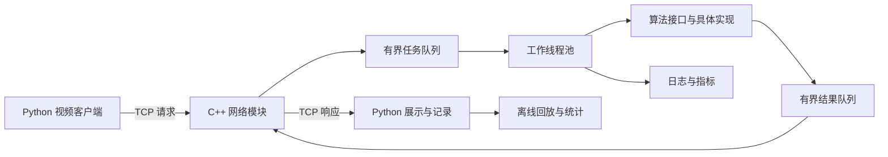

# VisionFlow：基于 C++ 的网络视觉处理与回放系统

> 文档状态：项目设计草案。当前仅建立项目说明，代码、构建配置、测试和部署脚本尚未实现。
>
> 本文中的目录、接口、配置项和运行命令是后续实现约定；除环境准备命令外，需完成对应阶段后才能执行。

## 1. 项目定位

构建一个部署在 Linux 上的视觉处理服务：Python 客户端读取视频并通过 TCP 发送图像，C++ 服务端完成任务调度和图像处理，再将结构化结果返回客户端展示、记录与回放。

项目以 C++ 工程能力为主线，覆盖网络通信、并发编程、资源管理、Linux 系统编程、调试与性能分析。道路视频处理是其中一种业务场景，也可扩展到工业视觉、视频分析等方向。

### 1.1 项目目标

- 使用 C++17 实现可维护、可测试的核心服务。
- 理解对象生命周期、内存所有权、模板、STL 和线程同步。
- 实现具有消息边界、大小限制和错误处理的 TCP 应用层协议。
- 支持有界任务调度、多客户端连接和可控的过载行为。
- 使用 OpenCV 完成基础视觉处理，使用 Python 完成输入、展示和压测。
- 使用 CMake 构建、Git 管理版本，并在 Linux 上完成运行和验证。
- 留下可复现的调试记录与性能数据，支撑简历和面试讲解。

### 1.2 范围与边界

- 第一版使用 CPU，不依赖 GPU 或模型训练。
- 首先处理文件视频，摄像头输入作为后续扩展。
- “实时预览”表示优先处理新帧、控制积压，不承诺硬实时截止时间。
- 传统道路区域线段提取用于教学演示，需要记录对弯道、遮挡、光照等情况的局限。
- 第一阶段面向本机或可信局域网；公网部署所需的认证、加密等另行设计。

## 2. 功能规划

| 功能 | 内容 | 优先级 |
| --- | --- | --- |
| 本地图像处理 | 读取图片，执行算法，保存结果 | 必做 |
| 网络请求与响应 | 发送 JPEG 图像，返回结构化检测结果 | 必做 |
| 算法切换 | 按启动配置选择边缘检测、道路线段提取 | 必做 |
| 并发任务处理 | 有界队列、工作线程池、任务关闭流程 | 必做 |
| 多客户端连接 | 非阻塞 IO、连接状态管理、发送缓存限制 | 完整版 |
| 结果展示与回放 | 叠加线段、显示耗时、保存输入与结果 | 完整版 |
| 日志与统计 | 请求量、错误、队列深度、延迟和丢帧 | 必做 |
| 进程管理 | C++ 监管程序启动、等待和终止服务子进程 | 完整版 |
| 性能分析 | 压测、定位瓶颈、对比优化结果 | 完整版 |
| 深度学习推理 | ONNX 模型、目标检测 | 可选扩展 |
| 动态算法插件 | 动态库加载与插件接口 | 可选扩展 |

## 3. 技术栈

| 分类 | 选型 | 用途 |
| --- | --- | --- |
| 核心语言 | C++17 | 服务端、算法接口、资源管理、并发调度 |
| 辅助语言 | Python 3 | 视频输入、结果展示、压测和统计 |
| 运行环境 | Linux；建议以 Ubuntu 22.04 或 24.04 LTS 为初始环境 | 系统编程与部署验证 |
| 编译器 | GCC；可增加 Clang 验证 | 编译、警告和 Sanitizer |
| 构建工具 | CMake 3.16+、Ninja | 模块化构建、Debug/Release 配置 |
| 版本管理 | Git | 阶段提交、标签、问题追踪 |
| 网络 | POSIX Socket、TCP、epoll | 图像与结果传输、多连接 IO |
| 并发 | std::thread、mutex、condition_variable、atomic | 线程池、队列、统计计数 |
| 视觉 | OpenCV 4.x | 图像编解码、预处理、线段提取 |
| 配置与结果格式 | JSON；计划使用 nlohmann/json | 配置读取和结果序列化 |
| 测试 | CTest；测试可执行程序及 Python 集成脚本 | 单元与集成验证 |
| 调试 | GDB、core dump | 崩溃和线程状态分析 |
| 动态检查 | AddressSanitizer、UBSan、ThreadSanitizer | 内存错误、未定义行为、数据竞争 |
| 性能分析 | strace、perf、系统进程工具 | 系统调用、CPU 热点和资源占用 |

原则：协议编解码、队列、线程池和资源封装自行实现；图像算法基础能力与 JSON 解析使用成熟库。

## 4. 系统架构



### 4.1 数据流

1. 客户端读取视频帧，生成请求编号并编码为 JPEG。
2. 服务端接收字节流，解析消息头，验证长度并组装完整请求。
3. 请求进入有界队列，工作线程取出任务。
4. 工作线程解码图像，执行算法并生成结果。
5. 结果进入有界结果队列，通知网络模块发送。
6. 客户端通过请求编号匹配结果，叠加显示并保存记录。

### 4.2 模块职责

| 模块 | 主要职责 | 关键设计 |
| --- | --- | --- |
| net | 监听、收发、连接和超时管理 | 网络线程拥有连接，维护每连接收发状态 |
| protocol | 消息编解码与校验 | 显式序列化字段，不直接发送结构体内存 |
| concurrency | 有界队列、工作线程池 | 明确关闭语义、过载策略和异常边界 |
| vision | 处理接口、算法工厂、OpenCV 算法 | 每个工作线程持有自己的处理器实例 |
| core | 配置、错误类型、日志、指标和资源包装 | 明确所有权，避免共享可变业务状态 |
| process | 服务子进程的启动、等待与信号控制 | 回收子进程，记录退出状态 |
| python | 视频输入、展示、回放与压测 | 同一客户端时钟测量端到端延迟 |

### 4.3 线程与连接约定

- 第一版先实现单客户端阻塞 IO，打通端到端流程。
- 完整版使用一个网络事件循环和可配置数量的工作线程。
- 网络事件循环统一执行连接上的接收、发送和关闭。
- 工作线程只处理数据，不直接向客户端 Socket 写入。
- 用事件通知机制唤醒网络循环，例如 Linux eventfd。
- 任务携带稳定的会话标识和请求编号，不仅使用文件描述符识别连接，避免描述符复用导致结果误投。
- 同一客户端的任务可能乱序完成，客户端按请求编号匹配，不假设返回顺序。
- 多连接版本先采用 epoll 水平触发，再视学习需要研究边缘触发。

## 5. 计划目录结构

以下目录在对应阶段逐步创建，当前并不代表已经存在。

```text
VisionFlow/
├── CMakeLists.txt
├── README.md
├── .gitignore
├── include/visionflow/
│   ├── core/
│   ├── net/
│   ├── protocol/
│   ├── concurrency/
│   ├── vision/
│   └── process/
├── src/
│   ├── core/
│   ├── net/
│   ├── protocol/
│   ├── concurrency/
│   ├── vision/
│   └── process/
├── apps/
│   ├── vision_server.cpp
│   ├── vision_cli.cpp
│   └── vision_supervisor.cpp
├── python/
│   ├── client.py
│   ├── replay.py
│   ├── benchmark.py
│   └── requirements.txt
├── configs/
│   └── server.json
├── tests/
│   ├── unit/
│   └── integration/
├── scripts/
│   └── smoke_test.sh
├── docs/
│   ├── architecture.md
│   ├── protocol.md
│   ├── debugging.md
│   └── performance.md
├── data/
│   └── README.md
└── reports/
```

构建目标计划拆为公共库、服务端、离线工具、监管程序和测试程序。构建产物统一放在 build/ 下，避免污染源码目录。大视频、运行日志、虚拟环境和生成结果默认不纳入 Git。

## 6. 核心接口与 C++ 知识点

### 6.1 算法接口与工厂

```cpp
class IProcessor {
public:
    virtual ~IProcessor() = default;
    virtual ProcessResult process(const Frame& frame) = 0;
};

std::unique_ptr<IProcessor> create_processor(const std::string& name);
```

Frame 和 ProcessResult 是待定义的业务类型。初始实现 EdgeProcessor 与 LaneLineProcessor，算法名称由启动配置指定。可变的帧间状态不在多个工作线程之间直接共享。

学习重点：继承、多态、虚析构、接口隔离、unique_ptr、工厂模式和动态分派。

### 6.2 模板有界队列

计划实现 BoundedQueue<T>，具备 push、pop 和 close 能力：

- 队列容量固定，同时考虑条目数和数据字节数限制。
- 入队和出队支持移动对象。
- 队列关闭后拒绝新任务，并唤醒所有等待线程。
- 使用谓词等待条件变量，处理虚假唤醒。
- 正常关闭选择排空队列；快速停止选择取消待处理任务，二者语义明确区分。

学习重点：模板实例化、头文件定义、移动语义、泛型约束、互斥同步和异常安全。完善阶段可通过 static_assert 明确元素类型要求。

### 6.3 STL 与现代 C++ 的应用

| 特性 | 应用场景 |
| --- | --- |
| vector | 图像编码字节、检测线段和结果集合 |
| deque | 有界任务队列的底层存储 |
| unordered_map | 连接状态表、算法创建函数注册表 |
| chrono | 超时、处理时长、性能统计 |
| optional | 表示无结果、已关闭等需要明确区分的状态 |
| Lambda | 算法创建函数、任务执行与条件变量谓词 |
| unique_ptr | 算法对象等独占资源 |
| atomic | 独立统计计数器 |
| enum class | 消息类型、错误类型与运行状态 |

### 6.4 RAII、所有权与生命周期

- 文件描述符包装类禁止复制、支持移动，析构时释放资源。
- 线程池负责线程的启动、停止与 join，不使用脱离管理的后台线程。
- 大对象通过移动转交所有权；仅在确有共享生命周期需求时引入 shared_ptr。
- cv::Mat 的普通复制可能共享像素内存，需要独立可写副本时使用 clone。
- 异步任务不能持有已经失效的局部对象引用。
- 服务关闭时先停止接收新任务，再按策略处理队列、等待线程、关闭连接，最后关闭日志。

学习重点包括栈与堆、对象构造析构、拷贝与移动、悬空引用、引用计数，以及 RAII 在异常路径上的作用。

### 6.5 内存模型与同步

- 区分 C++ 并发内存模型与 Linux 进程虚拟地址空间。
- 用互斥量保护共享状态，理解加锁与解锁建立的同步关系。
- 不使用 volatile 代替线程同步。
- 原子统计计数不承担发布其他共享数据的职责。
- 先使用默认原子内存序；只有明确证明正确性后，再研究更弱内存序。
- 后续通过实验理解数据竞争、缓存局部性与伪共享，不先实现无锁队列。

### 6.6 单例与日志

日志入口采用函数局部静态对象实现单例，内部对共享输出进行同步。初始化线程安全不等于所有成员函数线程安全。

日志至少包含时间、级别、线程信息、会话标识、请求编号和错误原因。业务模块尽量通过显式参数获得依赖，避免全局状态扩散。

## 7. TCP 协议草案

### 7.1 消息格式

固定 24 字节消息头，加可变长度消息体：

| 字段 | 长度 | 约定 |
| --- | --- | --- |
| magic | 4 字节 | ASCII 字节序列 VFLW |
| version | 2 字节 | 初始版本为 1 |
| message_type | 2 字节 | 1：图像请求；2：处理结果；3：错误响应 |
| request_id | 8 字节 | 当前会话内唯一 |
| payload_length | 4 字节 | 消息体字节数 |
| flags | 4 字节 | 保留，初始为 0 |

所有多字节整数使用网络字节序。字段逐个编码和解码，不依赖结构体填充、对齐或宿主字节序。

- 图像请求体：JPEG 字节，算法由服务配置决定。
- 结果响应体：UTF-8 JSON，包含请求编号、状态、检测结果和处理时长。
- 错误响应体：UTF-8 JSON，包含错误码与可读原因。
- 暂定最大消息体 16 MiB，可配置；分配接收缓冲区之前校验长度。
- 另行限制解码后像素数量和图像尺寸，不能仅依靠压缩文件大小限制内存使用。

### 7.2 必须处理的网络情况

- 消息头或消息体分多次到达。
- 多条消息连续到达。
- send/recv 的部分完成、EINTR、EAGAIN/EWOULDBLOCK。
- 对端关闭、连接重置、读写超时和发送失败。
- 非法版本、超长消息、损坏图片和未知消息类型。
- 客户端不读取响应，导致发送缓存积压。

使用 Socket 是调用内核提供的 TCP/IP 能力，项目不自行实现 TCP 协议栈。通过抓包和系统工具观察握手、挥手、重传、端口与连接状态。

## 8. 过载策略与错误处理

### 8.1 过载与背压

| 模式 | 队列满时的行为 | 目的 |
| --- | --- | --- |
| 实时预览 | 淘汰尚未执行的旧任务，记录并通知丢帧结果 | 优先处理新画面 |
| 离线分析 | 限制读取或限制客户端未完成请求数 | 保留已接受任务 |

完整版本为每个客户端设置未完成请求配额，避免单个客户端独占所有队列。网络循环不能因为等待队列空位而阻塞其他连接。结果队列、接收缓存、发送缓存都必须有界。

客户端断开后，丢弃属于失效会话的待发送结果。有限缓存和明确的清理流程共同控制内存增长。

### 8.2 错误分类

| 错误 | 处理方式 |
| --- | --- |
| 配置、监听等启动失败 | 报告原因，释放资源，以非零状态退出 |
| 无法解码图像或不支持的请求 | 返回请求级错误，继续处理其他合法请求 |
| 无法可靠恢复的协议错误 | 关闭对应连接，记录原因 |
| 算法异常 | 在线程任务边界捕获，转换为失败结果 |
| 客户端断开 | 清理会话，避免失效结果误投 |
| 服务停止 | 停止接入，按策略排空或取消任务，再释放资源 |

析构函数不向外抛异常。队列和资源包装至少保证失败后无泄漏、内部状态仍有效；需要强异常保证的操作通过先构造后提交等方式实现。

## 9. Linux 环境准备与构建流程

### 9.1 开发环境

Windows 用户可以使用 WSL2 或 Linux 虚拟机。以下命令在 Linux 终端中运行，不在 Windows PowerShell 中运行。建议将源码放在 Linux 文件系统中的工作目录。

Ubuntu 基础依赖安装示例：

```bash
sudo apt update
sudo apt install build-essential cmake ninja-build git gdb \
    pkg-config libopencv-dev nlohmann-json3-dev \
    python3 python3-venv python3-pip strace
```

perf 的安装包与运行内核有关，后续根据实际 Linux 环境安装；WSL 或容器下部分性能事件可能不可用。

### 9.2 CMake 约定

- 使用 target 级别的编译选项、头文件路径和依赖关系。
- 使用 find_package 查找 OpenCV、Threads 与 nlohmann_json。
- 使用 CTest 统一运行测试。
- 使用独立构建目录区分 Debug、Release 和 Sanitizer 配置。
- 计划提供 VISIONFLOW_ENABLE_ASAN、VISIONFLOW_ENABLE_UBSAN 和 VISIONFLOW_ENABLE_TSAN 选项，初始均关闭。
- ASan 与 TSan 使用不同构建目录，不能同时开启。

### 9.3 Debug 构建

以下命令从未来的项目根目录执行，待 CMakeLists.txt 实现后可用：

```bash
cmake -S . -B build/debug -G Ninja \
    -DCMAKE_BUILD_TYPE=Debug -DBUILD_TESTING=ON
cmake --build build/debug --parallel
ctest --test-dir build/debug --output-on-failure
```

### 9.4 Release 构建

```bash
cmake -S . -B build/release -G Ninja \
    -DCMAKE_BUILD_TYPE=Release -DBUILD_TESTING=ON
cmake --build build/release --parallel
ctest --test-dir build/release --output-on-failure
```

计划将可执行文件统一输出到对应构建目录的 bin/ 子目录。性能测量以 Release 为基准，不将 Debug 或 Sanitizer 构建的数据混在一起比较。

### 9.5 Python 环境

待 python/requirements.txt 创建后执行：

```bash
python3 -m venv .venv
source .venv/bin/activate
python -m pip install -r python/requirements.txt
```

计划依赖包括 numpy、opencv-python；性能图表需要时再加入 matplotlib。发布可复现版本时记录实际验证过的依赖版本。

## 10. 配置与运行约定

以下为未来 configs/server.json 的示例，并非已经生成的配置文件：

```json
{
  "listen_address": "127.0.0.1",
  "port": 9000,
  "worker_threads": 4,
  "max_clients": 8,
  "task_queue_capacity": 32,
  "mode": "realtime",
  "processor": "lane_lines",
  "max_payload_bytes": 16777216,
  "log_level": "info"
}
```

以上是初始实验参数，并非性能保证。实现时还需补充超时、每连接配额、总缓存预算和图像尺寸限制，并校验配置合法性。

计划提供的运行方式：

```bash
# 服务端：从项目根目录运行
./build/debug/bin/vision_server --config configs/server.json

# 客户端：在另一个终端中激活 Python 环境后运行
python python/client.py --host 127.0.0.1 --port 9000 \
    --video data/sample.mp4

# 本地离线处理工具
./build/debug/bin/vision_cli --input data/frame.jpg \
    --processor lane_lines --output reports/frame_result.json
```

sample.mp4 和 frame.jpg 为用户自行准备的合法样例，不随本文自动生成。跨机器运行时修改监听地址及客户端目标地址。

## 11. Linux 进程与部署学习

- 理解进程 PID、父子进程、文件描述符继承、退出码和僵尸进程。
- 监管程序通过 posix_spawn 启动服务，通过 waitpid 回收子进程。
- 使用管道传递少量状态信息，明确哪一端由哪个进程关闭。
- 用 SIGTERM 请求服务有序退出；不要在异步信号处理函数中执行复杂日志或加锁操作。
- 学习 ps、top、ss、/proc、文件权限、环境变量和动态库查找。
- 最终提供启动、停止和日志查看说明；可增加 systemd 服务配置。
- 自研监管程序用于学习和演示；systemd 部署时直接管理服务，避免两套自动重启机制互相干扰。

## 12. Git 管理约定

代码开始实现时初始化仓库；本文生成阶段不自动创建仓库或提交。

```bash
git init
git add README.md CMakeLists.txt .gitignore
git commit -m "chore: initialize VisionFlow project"
```

以上 git add 需等待列出的文件全部创建后执行。

- 每次提交对应一个能解释的功能、修复或文档变更。
- 避免把多个阶段全部压在一次提交里。
- 在通过验收的阶段打标签，例如 v0.1-local、v0.2-tcp、v0.3-concurrency。
- 提交源码、配置示例和测试；忽略 build/、.venv/、日志、大视频和自动生成结果。
- 有代表性的报告和小型测试样例可以明确纳入版本管理。
- README 随实际实现更新，持续区分已实现与计划功能。

## 13. 调试与测试

### 13.1 GDB

服务端实现并完成 Debug 构建后：

```bash
gdb --args ./build/debug/bin/vision_server --config configs/server.json
```

常用调试操作：

```text
break main
run
next
step
print variable_name
bt
info threads
thread apply all bt
```

至少保留一次崩溃定位和一次线程阻塞定位记录，包含复现输入、现象、调用栈、原因、修复与验证。问题演示放在独立测试或实验分支中，不把故意引入的错误保留在正常服务路径里。

### 13.2 Sanitizer

待对应 CMake 选项实现后：

```bash
cmake -S . -B build/asan -G Ninja \
    -DCMAKE_BUILD_TYPE=Debug -DBUILD_TESTING=ON \
    -DVISIONFLOW_ENABLE_ASAN=ON -DVISIONFLOW_ENABLE_UBSAN=ON
cmake --build build/asan --parallel
ctest --test-dir build/asan --output-on-failure
```

TSan 使用独立 build/tsan 目录，只启用 VISIONFLOW_ENABLE_TSAN，并运行并发相关测试。

### 13.3 关键测试场景

| 类别 | 验证内容 |
| --- | --- |
| 协议 | 拆分发送、连续消息、大小边界、错误版本、长度溢出检查 |
| 队列 | 空队列等待、满队列策略、关闭唤醒、取消与排空 |
| 网络 | 部分写入、发送中断线、慢客户端、重复连接、失效会话 |
| 算法 | 空输入、损坏图像、结果字段和尺寸边界 |
| 生命周期 | 部分初始化失败、重复启动停止、任务执行中停止 |
| 多进程 | 子进程正常退出、异常退出、父进程回收 |
| 集成 | Python 请求与 C++ 响应一致，错误可追踪 |

## 14. 性能测量与优化

### 14.1 指标与测量方法

| 指标 | 定义或测量方式 |
| --- | --- |
| 有效吞吐量 | 单位时间内成功完成的帧数 |
| 端到端延迟 | 客户端发送前至收到完整响应；使用同一单调时钟 |
| 服务端分段耗时 | 排队、解码、算法和响应准备分别计时 |
| P50/P95/P99 | 延迟分布的分位数 |
| CPU 与内存 | CPU 使用率、RSS 及随时间变化情况 |
| 队列深度 | 任务和结果队列的实时占用、峰值 |
| 丢帧与错误率 | 主动丢弃、输入错误和处理失败分别统计 |

不直接相减两台未同步机器的时间戳。压测客户端同时提供受控速率发送和请求响应模式，记录发送速率与未完成请求上限，避免只测低负载而忽略排队问题。

### 14.2 实验流程

1. 固定硬件、构建模式、输入视频、分辨率和算法参数。
2. 记录 OpenCV 自身线程配置，避免应用线程池与库内部线程叠加导致结果难以解释。
3. 进行预热，然后持续采样，记录试验时长和重复次数。
4. 比较不同客户端数量、工作线程数、图像大小和队列容量。
5. 使用 strace 观察系统调用，使用 perf 定位 CPU 热点。
6. 一次改变一个主要因素，保存优化前后数据与正确性检查结果。

候选优化：减少不必要的图像深拷贝、复用缓冲区、减少动态分配、调整线程数量、降低日志频率、优化编解码参数。对象池和内存池只在测量显示分配开销明显时引入。

不预先承诺帧率或优化比例。简历中的数值必须来自实际测试，并附带测试条件。

## 15. 分阶段路线与验收

建议先按每周 10–15 小时、总计约 8–10 周规划，按实际基础调整。

| 阶段 | 主要工作 | 验收条件 |
| --- | --- | --- |
| 1：本地闭环 | Linux、CMake、Git、单图处理 | 干净目录构建成功，正确处理不存在的输入文件 |
| 2：工程抽象 | 算法接口、工厂、日志、RAII | 能切换算法，初始化失败无资源遗留 |
| 3：TCP 闭环 | 协议、单客户端、Python 展示 | 拆包、连续消息、损坏图片和断线有正确行为 |
| 4：并发调度 | 模板队列、线程池、停止流程 | 过载时缓存受限，关闭能唤醒等待线程 |
| 5：多客户端 | 非阻塞 IO、epoll、连接配额 | 慢客户端不阻塞其他连接，失效结果不误投 |
| 6：视觉回放 | 道路线段提取、记录、回放 | 同一输入可重复演示并分析算法局限 |
| 7：进程部署 | 监管程序、信号、退出状态 | 子进程可正确回收，服务可有序退出 |
| 8：调试优化 | GDB、动态检查、性能实验 | 有复现记录、测量报告和优化前后证据 |

先完成阶段 1–4 的最小可用版本，再进入完整版本，避免一次性展开全部模块。

## 16. 知识覆盖检查表

- [ ] 基础语法：引用、指针、const、枚举、作用域、函数和类。
- [ ] 面向对象：封装、继承、多态、虚析构与接口设计。
- [ ] STL：vector、deque、unordered_map、常用算法及复杂度。
- [ ] 现代 C++：智能指针、移动语义、Lambda、chrono、optional。
- [ ] 模板：泛型队列、实例化、定义可见性、类型约束。
- [ ] 生命周期：构造析构、所有权转移、悬空引用、共享像素内存。
- [ ] 内存模型：数据竞争、同步关系、原子操作和可见性。
- [ ] 系统编程：进程、线程、文件 IO、系统调用和信号。
- [ ] 并发模型：生产者消费者、有界队列、背压、关闭与取消。
- [ ] 设计模式：算法工厂、日志单例，并能解释其边界。
- [ ] 资源与错误：RAII、异常安全、请求错误和系统错误分类。
- [ ] 网络：TCP/IP 分层、Socket、消息分帧、超时与连接管理。
- [ ] 工程工具：CMake、Git、CTest、GDB、Sanitizer。
- [ ] Linux：构建、权限、进程、端口、日志和部署。
- [ ] 视觉与 Python：OpenCV 处理、视频展示、回放和压测。
- [ ] 性能：明确指标、可复现实验、瓶颈定位和优化验证。

## 17. 最终交付物

- 可构建、可运行的 C++ 服务端、离线工具与监管程序。
- Python 视频客户端、回放工具和压测工具。
- 架构、协议、构建、配置和 Linux 运行说明。
- 单元测试、集成测试和代表性异常场景。
- 演示视频、问题定位记录、性能分析报告。
- 可追踪的 Git 提交历史与阶段标签。
- 与实际完成情况一致的简历描述。

## 18. 官方参考资料

- [CMake 官方教程](https://cmake.org/cmake/help/latest/guide/tutorial/index.html)
- [C++ Core Guidelines](https://isocpp.github.io/CppCoreGuidelines/CppCoreGuidelines)
- [Linux TCP 手册](https://man7.org/linux/man-pages/man7/tcp.7.html)
- [Linux epoll 手册](https://man7.org/linux/man-pages/man7/epoll.7.html)
- [GDB 多线程调试文档](https://www.sourceware.org/gdb/current/onlinedocs/gdb.html/Threads.html)
- [OpenCV Mat 文档](https://docs.opencv.org/4.x/d3/d63/classcv_1_1Mat.html)
- [OpenCV 霍夫直线检测教程](https://docs.opencv.org/4.x/d9/db0/tutorial_hough_lines.html)

## 19. 当前进度

- [x] 确定项目方向与初步架构。
- [x] 建立项目说明文档。
- [ ] 确认实际 Linux 开发环境与工具版本。
- [ ] 建立 CMake 工程和最小本地图像处理程序。
- [ ] 初始化 Git 仓库并建立忽略规则。
- [ ] 按第 15 节逐步实现并验收。
